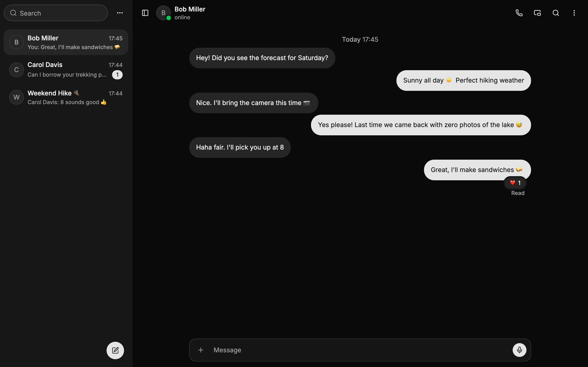

# Web Chat

[English](./README.md) ｜ 中文

类 Telegram 的聊天应用，完全运行在 Cloudflare 开发者平台上，按 Workers 免费套餐的额度设计。



示例：https://chat.jaze.top

[](https://deploy.workers.cloudflare.com/?url=https://github.com/Jazee6/web-chat)

## 特性

- 私聊与群组（最多 20 人）：回复、编辑、撤回、回应、置顶、转发、@提及、已读、输入中与在线状态
- 秘密聊天：MLS 端到端加密，支持多设备，媒体同样加密
- 图片、视频（浏览器内转码）、文件、语音消息、贴纸与链接预览
- 一对一语音 / 视频通话与屏幕共享（P2P + TURN），群组通话（Realtime SFU）
- 本地优先：消息存在浏览器里的 SQLite（WASM、OPFS），离线可用，多设备、多标签页同步；全文搜索在本机完成
- PWA：可安装、Web Push 通知、分享目标、会话画中画
- 联系人、拉黑、邀请链接、设备管理
- 使用自己的 OpenID Connect 身份提供方登录

## 架构

- 一个 Worker 同时提供前端静态资源、API（Hono + better-auth）与 WebSocket
- SQLite 后端的 Durable Object：每个用户一个 `UserDO`（对话列表、设备、连接），每个会话一个 `ChatDO`（消息日志、成员）
- D1 存放 better-auth 的用户、会话与账号
- R2 存放媒体：上传走预签名地址，读取直达桶的自定义域名，不经过 Worker
- 前端：React 19、TanStack Router、shadcn/ui、Vite；Leader 标签页里的同步 Worker 持有本地库与连接

## 部署

### 准备

- 一个 Cloudflare 账号
- 一个可以登记客户端的 OpenID Connect 身份提供方
- 一个接入 Cloudflare 的域名（zone），用作媒体桶的自定义域名
- [Bun](https://bun.sh)

`wrangler.jsonc` 的顶层是给你部署用的模板：Worker `web-chat-app`，跑在 `workers.dev` 上，vars 留空，部署后再填。`env.production` 是示例实例的配置，`bun run deploy` 与部署按钮都不会用到它。

### 方式一：一键部署

[](https://deploy.workers.cloudflare.com/?url=https://github.com/Jazee6/web-chat)

Cloudflare 会把本仓库复制到你的 GitHub 或 GitLab 账号，创建 D1 数据库、R2 桶与 Durable Object，执行 D1 迁移，并把应用部署到 `https://web-chat-app.<子域>.workers.dev`。之后每次往新仓库推送都会重新部署。

表单会要求填写 4 个机密。`BETTER_AUTH_SECRET` 用 `openssl rand -base64 32` 生成；这时还拿不到 OAuth 客户端密钥与 R2 令牌，先填占位，之后再替换。然后继续 [部署后](#部署后)。

### 方式二：手动部署

```sh
bun install
bunx wrangler login
bunx wrangler d1 create web-chat-app-directory
bunx wrangler r2 bucket create web-chat-app-media
bun run deploy                                  # 执行 D1 迁移、构建并发布
```

然后继续 [部署后](#部署后)，改完 `wrangler.jsonc` 再执行一次 `bun run deploy`。

### 部署后

#### 1. 身份提供方

在身份提供方登记一个客户端：

| 项 | 值 |
| --- | --- |
| 回调地址 | `https://<应用域名>/api/auth/callback/idp` |
| 登出后跳回 | `https://<应用域名>/` |
| 客户端认证方式 | `client_secret_basic` |
| Scope | `openid profile email`（开启 PKCE） |

#### 2. R2

在媒体桶（默认 `web-chat-app-media`）的设置里：

- **自定义域名**：绑定一个，例如 `r2.<你的域名>`。媒体凭不可猜测的地址公开读取。
- **CORS**：允许 `https://<应用域名>`（开发时再加 `http://localhost:5173`）的 `GET` 与 `PUT`，请求头 `content-type`、`content-disposition`、`cache-control`。
- **生命周期规则**：`p/` 下的对象 7 天后删除（上传了却没发出去的）；与开发环境共用桶时，`dev/` 下的对象 30 天后删除；未完成的分段上传 1 天后中止。
- **API 令牌**：R2 → Manage API tokens，创建一个对这个桶有 Object Read & Write 权限的令牌，用于签发上传地址。

#### 3. 配置

填写 `wrangler.jsonc` 顶层的 `vars`（见 [环境变量](#环境变量列表)）并提交；手动部署的执行 `bun run deploy`。`MEDIA_ORIGIN` 与 `VAPID_PUBLIC_KEY` 在构建时读取，而且每次部署都会覆盖控制台里设置的 vars，所以一律改 `wrangler.jsonc`。

可选：用 `bunx web-push generate-vapid-keys` 生成 Web Push 密钥对，公钥填进 `VAPID_PUBLIC_KEY`，私钥写入机密 `VAPID_PRIVATE_KEY`。不配置时没有推送通知。

想让应用用自己的域名而不是 `workers.dev`：加上 `"routes": [{ "pattern": "<应用域名>", "custom_domain": true }]`，并把 `"workers_dev"` 设为 `false`。

#### 4. 机密

在仓库根目录执行，或者在控制台（Worker → Settings → Variables and Secrets）里设置，替换占位并补上可选的机密：

```sh
bunx wrangler secret put OAUTH_CLIENT_SECRET
bunx wrangler secret put R2_ACCESS_KEY_ID
bunx wrangler secret put R2_SECRET_ACCESS_KEY
bunx wrangler secret put VAPID_PRIVATE_KEY      # 可选，推送通知用
bunx wrangler secret put TURN_KEY_ID            # 可选，见下文
bunx wrangler secret put TURN_KEY_API_TOKEN
bunx wrangler secret put SFU_KEY_ID
bunx wrangler secret put SFU_KEY_API_TOKEN
```

每个机密写入后立即生效。

#### 5. 检查

打开 `https://<应用域名>/api/auth/ok`：必填项都齐了时返回 `{"ok":true}`，否则列出缺了哪些。

### 环境变量列表

| 名称 | 类型 | 描述 | 必填 |
| --- | --- | --- | --- |
| BETTER_AUTH_URL | var | 应用对外的地址 | ✅ |
| OAUTH_DISCOVERY_URL | var | 身份提供方的 `/.well-known/openid-configuration` | ✅ |
| OAUTH_CLIENT_ID | var | 在身份提供方登记的客户端 ID | ✅ |
| R2_ACCOUNT_ID | var | Cloudflare 账户 ID（用于 R2 的 S3 端点） | ✅ |
| R2_BUCKET | var | 媒体桶名称，与 `r2_buckets` 一致 | ✅ |
| MEDIA_ORIGIN | var | 媒体桶的自定义域名，构建时读取 | ✅ |
| MEDIA_KEY_PREFIX | var | 对象键前缀：生产环境为空，开发环境为 `dev/` | |
| VAPID_PUBLIC_KEY | var | Web Push 公钥，构建时读取 | 使用推送时 |
| BETTER_AUTH_SECRET | secret | cookie 签名密钥，至少 32 字节随机值 | ✅ |
| OAUTH_CLIENT_SECRET | secret | 客户端密钥 | ✅ |
| R2_ACCESS_KEY_ID | secret | R2 API 令牌的 Access Key ID | ✅ |
| R2_SECRET_ACCESS_KEY | secret | R2 API 令牌的 Secret | ✅ |
| VAPID_PRIVATE_KEY | secret | Web Push 私钥（base64url，32 字节） | 使用推送时 |
| TURN_KEY_ID | secret | Realtime TURN key 的 ID | 使用通话时 |
| TURN_KEY_API_TOKEN | secret | Realtime TURN key 的 API 令牌 | 使用通话时 |
| SFU_KEY_ID | secret | Realtime SFU App 的 ID | 使用群组通话时 |
| SFU_KEY_API_TOKEN | secret | Realtime SFU App 的 Secret | 使用群组通话时 |

#### TURN_KEY_ID / SFU_KEY_ID

- 在控制台的 Realtime → TURN 与 Realtime → SFU 中创建
- 没有 TURN 时通话只用 STUN，无法直连的网络之间会失败；没有 SFU 时群组通话不可用

### 升级

数据只做前向迁移，旧版本的客户端会自动重载：

- **D1**：better-auth 的表结构变了时，用 `bun run --cwd server gen-auth-schema > server/migrations/000N_<名字>.sql` 生成迁移，发布时会先执行。
- **Durable Object** 与**本地库**：在 `server/src/user-do.ts`、`server/src/chat-do.ts` 或 `web/src/sync/store.ts` 的 `MIGRATIONS` 末尾追加一步，不改已有的步骤。
- **协议**：消息格式不兼容时，把 `shared` 里的 `PROTOCOL_VERSION` 加 1。

> **注意：** 改了表结构的发布不能回滚。被新版本访问过的数据比旧代码新，旧代码会拒绝打开。出了问题修好后往前再发一版。

## 开发

```sh
bun install
cp .dev.vars.example .dev.vars                  # 填入机密，并取消开发用那几行的注释
bun run --cwd web db:migrate
bun run dev                                     # http://localhost:5173
bun run test
```

开发环境使用 `wrangler.jsonc` 顶层的 `vars`，由 `.dev.vars` 覆盖；使用真实的 R2 桶，对象放在 `dev/` 前缀下。用其他环境时在命令前加 `CLOUDFLARE_ENV=<名字>`，示例实例的 `bun run dev:production` 与 `bun run deploy:production` 就是这样做的。

## 赞助

[Click Me](https://jaze.top/sponsor)
