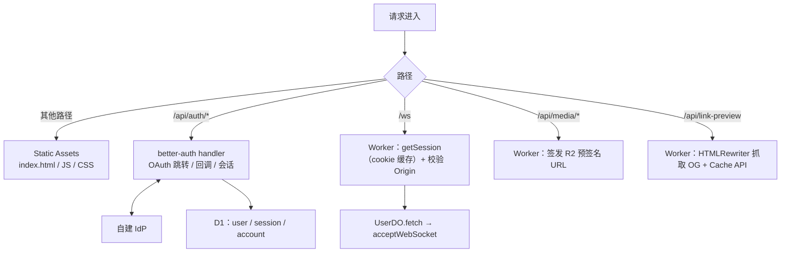
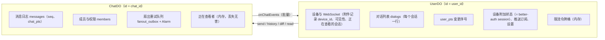

# 01 · 运行时拓扑

## 产品选型

| 需求 | 选用 | 不选 / 推迟 | 理由 |
| --- | --- | --- | --- |
| SPA 托管 | Workers Static Assets | Pages | 与 API 同一个 Worker 部署；静态资源请求免费且不限量 |
| HTTP API | Worker + Hono | — | 已安装；只处理登录、上传签名、WebSocket 升级等少量请求 |
| 实时连接 | Durable Object WebSocket Hibernation | 普通 WebSocket、Cap'n Web 长会话 | 免费额度只有 13,000 GB-s/天，按 128MB 计算，相当于**全账号每天约 29 个 DO·小时**的活跃时长。不休眠的连接会迅速耗尽（[ADR-0003](../adr/0003-single-hibernating-websocket.md)） |
| 会话状态 / 消息 | `ChatDO`（SQLite 后端） | D1 存消息 | 单线程 Actor 天然解决序号分配与并发问题；免费账号每个对象 1GB |
| 用户状态 / 对话列表 | `UserDO`（SQLite 后端） | D1、KV | 按用户隔离，同时也是 WebSocket 的落点 |
| 身份 | better-auth 1.7.x（Generic OAuth → 自建 IdP）+ D1 | Passkey、自研令牌、KV 会话 | 身份由可信 IdP 提供，5 个必要参数来自环境变量；better-auth 原生支持 D1（[06](./06-auth-and-security.md)） |
| 全局查找 | D1 | 单例 DO、KV | 用户资料、用户名唯一约束；D1 支持读副本 |
| 媒体 | R2（绑定自定义域名，公开读） | Cloudflare Images 存储 | Images 存储是付费功能，免费转换额度只有 5,000 次/月，因此缩略图由客户端生成 |
| 异步长任务 | Workflows（账号删除、会话解散等级联清理） | Queues 用于热路径 | Queues 免费额度只有 10,000 次操作/天，不进消息热路径 |
| 定时任务 | DO Alarm（定时消息、自毁消息、扇出重试） | Cron Triggers | 每个对象独立计时，不需要全局扫描 |
| 通话（第三阶段） | Realtime SFU + TURN | 自建信令服务器 | 免费 1,000 GB/月出站流量；信令复用现有 WebSocket |
| 机器翻译 / 摘要（可选） | Workers AI | — | 可选功能，不进核心路径 |
| 缓存 | Cache API（链接预览等） | KV | KV 免费额度只有 1,000 次写/天 |

**明确不用 KV 存会话或消息状态**：写入额度太低。

## 单 Worker 部署

整个后端就是一个 Worker（`server/`），配置在 `server/wrangler.jsonc`：

- 绑定：`USER` / `CHAT` 两个 SQLite 后端的 Durable Object、D1 `DIRECTORY`（better-auth）、R2 `MEDIA`（媒体桶）。静态资源由 `web` 的 vite 构建产出，`/api/*` 与 `/ws` 先进 Worker，其余路径走 SPA。
- 顶层就是生产配置：自定义域名 `chat.jaze.top`，关闭 `*.workers.dev` 与预览地址（其他 Origin 过不了 Origin 校验）。本地开发由 `server/.dev.vars` 覆盖 `vars`。
- 机密通过 `wrangler secret` 注入：`BETTER_AUTH_SECRET`、`OAUTH_CLIENT_SECRET`、`VAPID_PRIVATE_KEY`、`R2_ACCESS_KEY_ID` / `R2_SECRET_ACCESS_KEY`（用于预签名），以及通话用的 `TURN_KEY_*` / `SFU_KEY_*`。本地开发时这些值都写在 `.dev.vars` 中（不提交）。环境变量的完整说明见 [06 § 环境变量](./06-auth-and-security.md#环境变量)，部署步骤见 [README](../../README.zh.md#部署)。

## 请求路由

- **业务调用几乎都经过 WebSocket**：一条入站 WS 消息按 1/20 个 DO 请求计费，也不消耗 Worker 请求额度（Worker 请求免费 10 万/天）。HTTP 只用于无法走 WS 的场景：登录 / 登出（better-auth）、上传签名、链接预览。
- **`ChatDO` 从不直接暴露给公网**：只有 `UserDO` 和 Worker 通过 RPC 调用它。调用方身份由可信的 `UserDO` 传入，由 `ChatDO` 做成员与权限校验。

## Durable Object 职责边界

**所有权规则**：成员关系以 `ChatDO.members` 为准，`UserDO.dialogs` 是派生视图。每次变更都先写 `ChatDO`，再扇出到 `UserDO`，失败时由 `ChatDO` 的扇出重试队列（`fanout_outbox`）负责重试。

## 会话 ID 设计

| 类型 | ID 形式 | 说明 |
| --- | --- | --- |
| 私聊 | `p:{小uid}:{大uid}` | 由两个用户 ID 确定性生成，不需要查目录，也不会因竞态重复创建 |
| 群组 | `g:{128bit base32}` | 随机；上限 20 人 |
| 用户 | better-auth 的 `user.id` | 首次通过 IdP 登录时生成 |

所有 DO 统一用 `env.X.getByName(id)` 定位。

## 利用平台特性获得的正确性

- **单线程 + 输入门（Input Gate）**：`ChatDO` 内 `seq` / `chat_pts` 的分配天然串行，不需要锁。
- **输出门（Output Gate）**：SQLite 写入确认持久化之前，响应不会发出。客户端收到 `seq` 就意味着消息已落盘。
- **同步 SQL**：`ctx.storage.sql.exec` 是同步调用，单次事件内的多条写入天然原子（隐式事务）。
- **序号不落计数器行**：`top_seq` / `chat_pts` / `user_pts` 在对象唤醒时（`blockConcurrencyWhile`）用 `max()` 查询恢复（`messages` 走 `pts` 索引，`dialogs` 表很小，直接扫描），之后只保存在内存里。这样每条消息少写一行。
