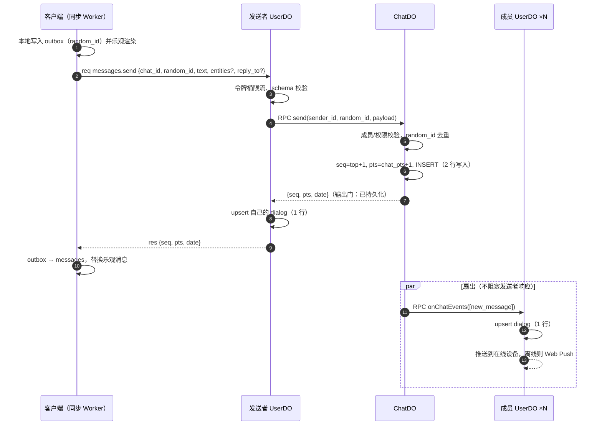
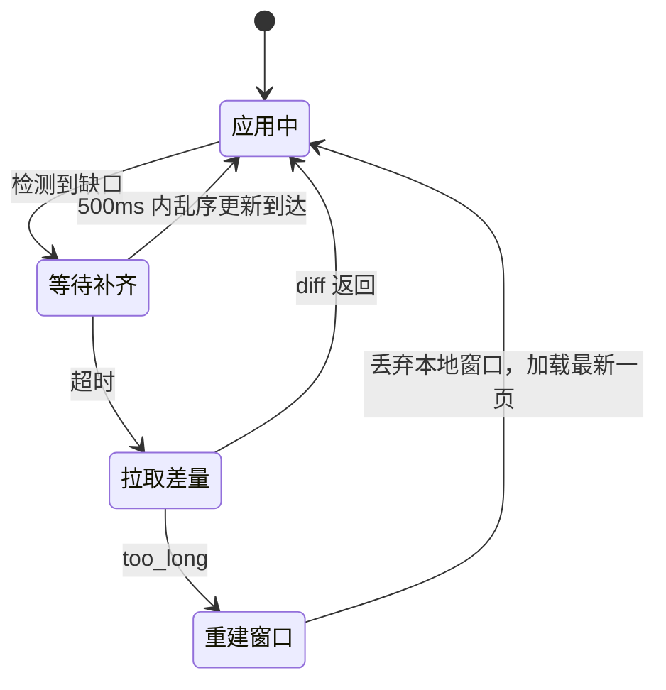
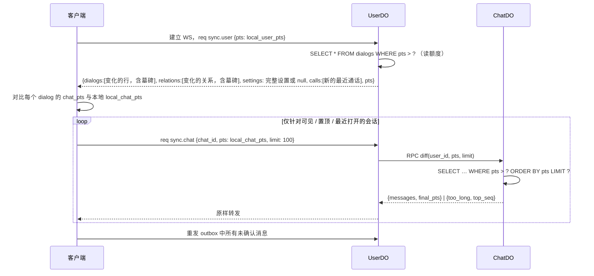

# 03 · 同步协议

参考 Telegram MTProto 的 `pts` / `getDifference` 模型，按 Cloudflare 的计费结构做了取舍。

## 传输与帧格式

- 每台设备一条 WebSocket：`wss://{host}/ws?v={PROTOCOL_VERSION}`，由 `UserDO` 用 Hibernation API 接收。
- 协议版本 `PROTOCOL_VERSION` 在帧、方法或更新的格式有不兼容的变化时加一。服务端不兼容旧版本：Worker 在鉴权之前比对查询参数 `v`，不一致时接受连接后立即以 `4002` 关闭（浏览器看不到升级失败的 HTTP 状态）。见 [ADR-0013](../adr/0013-forward-only-migrations-after-1-0.md)。
- 文本帧 + JSON。协议类型与 Valibot schema 放在共享包 `shared/protocol`，前后端共用，服务端对每个入站帧做校验。
- 心跳：客户端每 30s 发送字面量 `ping`，由 `setWebSocketAutoResponse` 直接回复 `pong`。**不唤醒 DO，也不计费。**

```ts
// 客户端 → 服务端
type Req = { t: 'req'; id: number; m: Method; p: unknown }
// 服务端 → 客户端
type Res = { t: 'res'; id: number; ok: true; r: unknown } | { t: 'res'; id: number; ok: false; e: ErrorCode; user_ids?: string[] }
type Upd = { t: 'upd'; u: Update[] }        // 持久更新：带序号，可补齐
type Evt = { t: 'evt'; e: Transient[] }     // 瞬时事件：输入中、在线状态；丢了无害
```

`Method` 按领域分组：`sync.*`、`dialogs.*`、`messages.*`、`chats.*`、`users.*`、`contacts.*`、`devices.*`、`presence.*`、`calls.*`、`group_calls.*`。错误的 `user_ids` 只在 `blocked` 时出现，指出拉黑了发起者的人。媒体上传走 HTTP（见 [05](./05-media.md#上传)），不在 WS 协议内。

## 三种序号

| 序号 | 作用域 | 何时递增 | 用途 |
| --- | --- | --- | --- |
| `seq` | 会话 | 每条新消息（含服务消息）+1 | **排序**与分页；消息的永久 ID |
| `chat_pts` | 会话 | 任何消息变更（新建、编辑、撤回、回应）+1 | 会话内**增量同步**；每条消息记录自己最近一次变更的 `pts` |
| `user_pts` | 用户 | 任一对话行、账号设置、关系变化或新的最近通话 +1 | **对话列表**、账号级设置、关系与最近通话的增量同步 |

为什么需要两种会话序号：编辑和撤回不改变 `seq`，但必须能被增量同步到。`chat_pts` 相当于 Telegram 超级群 / 频道的 `pts`，`seq` 相当于 `message_id`。

## 发送消息



- **链接预览**：纯链接的文本消息可以在 `messages.send` 里带 `preview`（卡片由发送方生成，校验规则见 [05 § 链接预览](./05-media.md#链接预览)）；编辑时链接没变则保留卡片，否则去掉。
- **媒体消息**走 `messages.sendMedia {chat_id, random_id, media, reply_to?}`，流程相同。媒体须已上传，`UserDO` 校验每个对象键都是发送者的待发键，复制到发送后的键再交给 `ChatDO`；待发对象已过期被删时返回 `media_expired`，客户端重新上传后再发（见 [05 § 孤儿对象](./05-media.md#孤儿对象)）。
- **一次发送拆成多条**：相册 → 各个文件 → 文字，同一事务入队。同一会话的发件箱严格按入队顺序逐条发送：前一条没有得到结果（包括媒体还在上传），后一条就不发。失败的留在原位，后面的照常发送。
- **幂等**：同一个 `(sender_id, random_id)` 在 10 分钟内重复提交时，返回第一次的 `{seq, pts, date}`，不会重复写入。
- **重连后重发 outbox**：
  - 创建不到 10 分钟的条目：直接重发，由服务端去重。
  - 更早的条目：先对所在会话执行 `sync.chat`，用返回消息里自己的 `random_id` 对账，只重发确实没有落库的条目。这样可以避免"确认丢失，几小时后才重连"导致的重复消息。
- **多设备回显**：发送者的其他设备通过 `UserDO` 直接收到该消息的更新，不再经过扇出。发起设备自己也会收到这组 `upd`（其中的 `user` 更新推进 `user_pts`，否则会出现缺口），并且**先于** `res` 到达，客户端要能先按 `random_id` 对账 outbox。
- **发送即已读**：发送成功后，把发送者的 `last_read_seq` 设为新 `seq`（与 Telegram 一致），保证 `unread = top_seq − last_read_seq` 不会把自己发的消息算进未读。

## 接收与缺口检测

每个持久更新都带有它所在序列的前后位置：

```ts
type Update =
  | { k: 'chat'; chat_id: string; pts: number; pts_count: number; ev: ChatEvent }  // 会话序列
  | { k: 'user'; pts: number; ev: UserEvent }                                      // 用户序列
```

客户端对每条序列执行同一个规则（与 Telegram 相同）：

- `local + pts_count == pts`：应用，`local = pts`。
- `local + pts_count > pts`：已应用过，丢弃。
- `local + pts_count < pts`：**出现缺口**。缓存该更新，等 500ms；若缺口仍未补齐，调用对应的 `diff`。



## 断线重连与差量同步



- `sync.user` 一次就能拿回对话列表的全部变化，成本 = 1 个 WS 消息（1/20 请求）+ 扫描几百行读取。
- `sync.chat` **懒加载**：只同步用户会看到的会话，其余会话等打开时再同步。每次同步 = 1 个 `ChatDO` 请求。
- **打开会话时总是先执行一次 `sync.chat`**。这是"只推不存"类更新的补齐点（见下一节）。返回里另带当前置顶消息的 `seq` 列表（`pinned`，后置顶的在前，前成员只含离开前的），本地没有的随即用 `messages.get` 拉取。
- `too_long`：变化超过 `limit` 时，客户端丢弃该会话的本地消息窗口，从 `top_seq` 往回加载一页，其余靠向上滚动时分页补齐（等价于 Telegram 的 `channelDifferenceTooLong`）。

## 哪些更新持久化到 UserDO

为了节省行写入，`ChatDO` 的事件按是否影响对话列表摘要分成两类：

| 事件 | 写 `UserDO.dialogs` | 推送给在线设备 | 离线设备如何补齐 |
| --- | --- | --- | --- |
| 新消息 | ✅ `top_seq`、`top_preview`、`chat_pts`；提及我（或回复我）时记进未读提及 | ✅ | `sync.user` |
| 编辑 / 撤回**最后一条**消息 | ✅ 摘要有变化时更新 `top_preview`，并前移 `chat_pts`（迟到的原消息重试不会把旧内容写回摘要） | ✅ | `sync.user` |
| 编辑 / 撤回其他消息、回应、置顶 / 取消置顶（后两者不改变摘要，最后一条也不写） | ❌ | ✅ | 打开会话时 `sync.chat` |
| 对方已读 | ✅ `peer_read_seq` | ✅ | `sync.user` |
| 成员变化、会话资料 | ✅（同时生成服务消息；扇出时附带当前会话资料 `{kind, title}`，被移除的人也会收到） | ✅ | `sync.user` |
| 账号设置 | ✅ `settings` 行（每项 1 行，同一次修改共用一个 `user_pts`） | ✅ | `sync.user`（有变化时返回完整设置） |
| 联系人、备注名、拉黑 | ✅ `relations` 行（每个对方 1 行；取消后保留墓碑） | ✅ | `sync.user` |
| 我的贴纸 | ✅ `stickers` 行（每张 1 行；移除后保留墓碑，以 `sticker: null` 下发） | ✅ | `sync.user` |
| 置顶、静音、草稿 | ✅ `dialogs` 行（`dialogs.update`，1 行） | ✅ | `sync.user` |
| 最近通话（通话记录到达时） | ✅ `calls` 行 | ✅ | `sync.user` |
| 输入中、在线状态 | ❌（瞬时 `evt`） | ✅ | 不补 |

## 其他方法（节选）

| 方法 | 路由 | 说明 |
| --- | --- | --- |
| `messages.history {chat_id, before_seq, limit}` | UserDO → ChatDO | 向上分页 |
| `messages.sendSticker {chat_id, random_id, key, reply_to?}` | UserDO → ChatDO | 发送我的贴纸里的一张：只接受自己收藏里（未移除）的键，格式与尺寸取自收藏行；消息引用同一个对象，不复制。写入与发送媒体消息相同，但不清空草稿。见 [05 § 贴纸](./05-media.md#贴纸) |
| `messages.get {chat_id, seqs}` | UserDO → ChatDO | 按 seq 取消息，用于渲染本地没有的回复引用与置顶消息；超出读取范围的 seq 直接略过 |
| `messages.edit {chat_id, seq, text, entities?}` | UserDO → ChatDO | 只能编辑自己的文本消息，发送后 1 小时内；更新 `pts`，文字与提及都没变时不写入。提及随之替换，但不产生新的未读提及。私聊拉黑期间返回 `blocked`（编辑会推给对方，等同于发消息） |
| `messages.recall {chat_id, seq}` | UserDO → ChatDO | 只能撤回自己的文本消息，发送后 2 分钟内；消息变为 `kind = recalled` 的墓碑，重复撤回不写入 |
| `messages.react {chat_id, seq, emoji}` | UserDO → ChatDO | 回应文本或媒体消息：`emoji` 取自 `REACTIONS`，`null` 表示取消；每人一个，选别的即替换。只有当前成员可以回应，没有时限；没有变化时不写入。更新 `pts` 后以 `update_message` 扇出，成员的 `UserDO` 不写对话行，也不推送通知。私聊拉黑期间返回 `blocked` |
| `messages.forward {from_chat_id, seq, to_chat_id, random_id}` | UserDO →（来源）ChatDO →（目标）ChatDO | 转发一条自己读得到的文本或媒体消息（前成员可以转发离开前的历史），成为自己在目标会话里的新消息，带 `fwd_from`（来源本身是转发来的就沿用它的）。媒体先在服务端复制到自己名下。一次转发到多个会话时每个会话各调用一次、各用各的 `random_id`，附带的文字由客户端在之后另发一条。目标是自己拉黑了的私聊时在复制之前就返回 `blocked` |
| `messages.pin {chat_id, random_id, seq}` | UserDO → ChatDO | 置顶文本或媒体消息：群组只有群主可以，私聊双方都可以。改写被置顶的消息，再追加一条 `message_pin` 服务消息（计入未读、不推送），两者合并成一次扇出。已经置顶着时返回 `null`、不写入；超过 `MAX_PINNED_MESSAGES` 返回 `pin_limit`；私聊拉黑期间返回 `blocked`。带 `random_id`，与发送消息共用去重窗口 |
| `messages.unpin {chat_id, seq}` | UserDO → ChatDO | 取消置顶：权限同置顶，只改写消息、不产生服务消息；拉黑期间也可以。没有置顶时不写入 |
| `messages.read {chat_id, max_seq}` | UserDO（私聊再到 ChatDO） | 只前移、截到 `top_seq`；客户端节流：同一会话每 2 秒最多一次 |
| `dialogs.update {chat_id, pinned?, muted_until?, draft?}` | UserDO | 置顶对话、静音与草稿：只写有变化的项，1 行写入，没有变化不写；递增 `user_pts`。置顶超过 5 个返回 `pin_limit`；草稿只有成员能写，`null` 或空草稿表示清除 |
| `chats.create {chat_id, random_id, title, user_ids}` | UserDO → ChatDO | 建群：`chat_id` 由客户端生成；至少 1 名其他成员。有人拉黑了建群者时整体失败（`blocked` + `user_ids`） |
| `chats.addMembers / removeMember / leave / editTitle` | UserDO → ChatDO | 任何成员可拉人，新加的人里有人拉黑了发起者时整体失败（同建群）；移除、改名仅群主。都产生一条服务消息，先写 ChatDO，再扇出；带 `random_id`，与发送消息共用去重窗口 |
| `chats.getInvite / resetInvite {chat_id}` | UserDO → ChatDO | 邀请链接：当前成员都能拿到邀请码，第一次有人要时生成令牌（1 行写入），之后只读；只有群主能重置（1 行写入），旧链接随之失效，不产生服务消息 |
| `chats.checkInvite {code}` | UserDO → ChatDO | 打开邀请链接：返回群名、当前人数与自己是否已经是成员，只读不写库。令牌不对、或群组已经没有成员（所有人都退出后没有群主，不能凭链接复活）返回 `not_found`；被群主移除、还没被拉回来的人返回 `forbidden` |
| `chats.join {code, random_id}` | UserDO → ChatDO | 凭邀请链接加入：校验同 `checkInvite`，群已满返回 `chat_full`，已是成员返回 `bad_request`；不受任何人拉黑的影响。产生一条 `member_join` 服务消息（不推送），前成员加入后恢复为成员。写入 3 行（成员 1 行 + 服务消息 2 行），带 `random_id`，与发送消息共用去重窗口 |
| `chats.get {chat_id}` | UserDO → ChatDO | 群资料与当前成员，只对当前成员开放；客户端打开群组、成员变化时刷新 |
| `settings.set {last_seen?}` | UserDO | 只写有变化的项；经 `user_pts` 同步到所有设备 |
| `contacts.set {user_id, alias}` | UserDO（→ D1 校验对方存在） | 加为联系人或修改备注名（空串等于不设）；没有变化时不写。不能加自己 |
| `contacts.remove {user_id}` | UserDO | 取消联系人，备注名一并清除；与拉黑互不影响 |
| `stickers.add {from: 'upload', key, w, h, size, thumbhash}` / `{from: 'message', chat_id, seq}` | UserDO（→ ChatDO） | 添加到我的贴纸：上传的待发对象复制到 `s/`；或引用一条读得到的贴纸消息里的贴纸。已有 200 张返回 `sticker_limit`；已经在收藏里的不写；1 行写入，经 `user_pts` 推给所有设备 |
| `stickers.remove {key}` | UserDO | 从我的贴纸移除：留墓碑（1 行写入），不删对象；没有时不写 |
| `users.block / users.unblock {user_id}` | UserDO → 私聊 ChatDO | 先让私聊的 `ChatDO` 记下或清除拉黑，再写自己的 `relations` 行。拉黑期间私聊双方发送、编辑都返回 `blocked`，不写任何行；输入中不转发；拉黑者的已读不推给对方。见 [ADR-0007](../adr/0007-block-rejects-explicitly.md) |
| `dialogs.delete {chat_id}` | UserDO | 删除只读对话：写墓碑行、递增 `user_pts`。秘密聊天对双方生效：`ChatDO` 删掉内容，另一方的 `UserDO` 也删掉对话 |
| `presence.update {visible, viewing[]}` | UserDO（→ ChatDO、对方 UserDO） | 设备状态写入 WS 附件；向正在查看的会话登记为查看者，并观察私聊对象的在线状态。连上后先发一次，变化时再发，查看期间每 50 秒续订。返回私聊对象的在线状态，以及查看的群组里进行中的通话（`group_calls`，横条用） |
| `presence.typing {chat_id, action}` | UserDO → ChatDO | `action` 为 `typing`（打字）或 `recording`（录语音消息）；只转发给正在查看该会话的其他成员 |
| `calls.start {chat_id, call_id}` | UserDO → ChatDO → 对方 UserDO | 发起一对一通话，`call_id` 由主叫方生成（重放返回同一个通话，结束后重放返回结束的通话）。自己已在别的通话里返回 `busy`；对方忙线时返回已结束（`busy`）的通话；对方正好在呼叫我时返回对方的来电。返回 `{call, ice_servers}`。见 [04 § 通话](./04-realtime-and-fanout.md#通话) |
| `calls.accept {chat_id, call_id}` | UserDO → ChatDO | 在本设备接听；已被其他设备接走或已结束返回 `call_ended` |
| `calls.end {chat_id, call_id}` | UserDO → ChatDO | 挂断、拒绝或取消，由状态判定；已结束的不报错 |
| `calls.signal {chat_id, call_id, data}` | UserDO → 对方 UserDO | 发给对方通话所在设备的信令（压缩后的 SDP），返回 `delivered`；只有本端通话所在的设备能发，不经过 ChatDO，不写库 |
| `calls.current {}` | UserDO（→ ChatDO） | 每次连上后询问：正在响铃的来电，或本设备上的通话（同时认领回来，取消断线期限，带上 `ice_servers`）；本设备上的群组通话在 `group_call` 里 |
| `group_calls.join {chat_id, call_id}` | UserDO → ChatDO | 在本设备加入群组里进行中的通话，没有时以 `call_id` 发起（写通话记录）。发起者开麦，其余人静音加入；已经在别的设备上的转到本设备，同一台设备重新加入时换新的 SFU session。自己已在别的通话里返回 `busy`。返回 `{call, ice_servers}`。见 [04 § 群组通话](./04-realtime-and-fanout.md#群组通话) |
| `group_calls.leave {chat_id, call_id}` | UserDO → ChatDO | 离开；最后一人离开时结束 |
| `group_calls.publish {chat_id, call_id, sdp, tracks[{mid, slot}]}` | UserDO → ChatDO → SFU | 发布 `mic` / `camera` / `screen`：`sdp` 为压缩的 offer，返回 SFU 的 answer。以下 `group_calls.*` 只有参与者所在的设备能调用 |
| `group_calls.unpublish {chat_id, call_id, sdp, slots[]}` | UserDO → ChatDO → SFU | 停止发布：`sdp` 为停掉收发器之后压缩的 offer，返回 answer |
| `group_calls.pull {chat_id, call_id, tracks[{user_id, slot, rid?}]}` | UserDO → ChatDO → SFU | 拉取别人的媒体，服务端换算成 SFU 的 session 与 track 名；摄像头按 `rid` 选层（默认 `h`）。返回 SFU 的 offer 与每一路的 `track`、`mid`（已经不在发的为 `error: gone`） |
| `group_calls.answer {chat_id, call_id, sdp}` | UserDO → ChatDO → SFU | 回给 SFU 的 answer（压缩），不写库 |
| `group_calls.layer {chat_id, call_id, mid, user_id, rid}` | UserDO → ChatDO → SFU | 换一路摄像头的 simulcast 层，不写库 |
| `group_calls.mute {chat_id, call_id, muted}` | UserDO → ChatDO | 麦克风静音与否，只是告诉其他参与者 |
| `users.resolve {email}` | UserDO → D1 | 按邮箱查找用户以添加联系人：忽略大小写的精确匹配，返回 `{id, name, image}` |
| `users.get {ids}` | UserDO → D1（读副本） | 资料批量获取；不返回邮箱，防止被批量枚举 |
| `secrets.keys / secrets.publish` | UserDO | 秘密聊天：本设备在服务端还有几个一次性 KeyPackage（并告知本设备的 ID）；补齐或整个换掉（本地数据丢了）。第一次上传或换掉时通知所有秘密聊天，成员设备随之把它拉进来。见 [06 § 端到端加密](./06-auth-and-security.md#端到端加密) |
| `secrets.prepare {user_id} / secrets.create {chat_id, random_id, welcome, adds}` | UserDO →（对方 UserDO）→ ChatDO | 开始秘密聊天：只能与联系人，同时最多一个；先领双方设备的 KeyPackage，在客户端建组，再把 Welcome 交给服务端（纪元 1，写一条 `secret_create` 服务消息）。对方没有设备上传过 KeyPackage 返回 `no_keys` |
| `secrets.state / secrets.claim / secrets.commit / secrets.commits / secrets.reset` | UserDO →（UserDO）→ ChatDO | 组里的设备与双方现有设备的差异、领取要加入的设备的 KeyPackage、提交（只接受当前纪元 + 1，否则 `stale_epoch`）、按纪元取提交（Welcome 只给被加入的设备）、请成员把丢了状态的本设备重新加入。有了新提交或待处理的设备时以瞬时事件 `secret` 通知成员 |
| `secrets.send / secrets.edit / secrets.react` | UserDO → ChatDO | 秘密聊天的发送、编辑与回应：内容是用当前纪元的密钥加密的密文，纪元不对返回 `stale_epoch`（客户端追上提交后重新加密再发）。媒体先加密上传，`secrets.send` 的 `keys` 为待发键，服务端复制到发送后的键（见 [05 § 秘密聊天的媒体](./05-media.md#秘密聊天的媒体)）。其余规则与 `messages.*` 相同；撤回、已读沿用 `messages.recall`、`messages.read` |
| `devices.list {}` | UserDO → D1 | 以未过期的 session 为准，合并 `devices` 行与在线连接的状态；本机在前。不进本地库，打开设备页时拉取 |
| `devices.revoke {device_id}` | UserDO → D1 | 移除设备：删除 D1 中该用户的这条 session，记录 `revoked_at`，以关闭码 `4001` 断开它；不能移除本机 |
| `devices.revokeOthers {}` | UserDO → D1 | 移除除本机以外的所有设备，包括 session 已过期但连接还在的设备 |

### 关闭码

| 关闭码 | 含义 | 客户端 |
| --- | --- | --- |
| `4000 replaced` | 同一设备的新连接顶替了旧连接 | 永久停止，不重连（否则两边会互相踢下线） |
| `4001 revoked` | 本设备已被移除；cookie 缓存期内的重连也会立即收到它 | 先调用 `sign-out` 清掉 cookie，再删除本地库，显示"本设备已被移除"，不自动跳转 IdP |
| `4002 outdated` | 客户端的协议版本与服务端不一致 | 永久停止，所有标签页重载（见 [07 § 新版本](./07-client.md#新版本)） |

### 瞬时事件

`evt` 不落库、不占序号，丢了不补：输入中（`typing`）、在线状态（`presence`）、通话状态（`call`：来电、接听、结束，推给双方的所有设备）、通话信令（`call_signal`：只推给本端通话所在的设备）、群组通话（`group_call`：房间的快照，结束时为 null，推给参与者与正在查看这个群组的成员；`mine` 表示通话就在这台设备上）、秘密聊天（`secret`：有了新提交或待处理的设备，成员设备拉取状态与提交；丢了由连上、打开会话时的检查补齐）。通话状态丢了由重连后的 `calls.current` 补齐，信令由 `calls.signal` 的 `delivered` 告知发送方重试。

## 前成员与重新加入

- `sync.chat` 对前成员只返回 `seq ≤ left_seq` 的消息，但同步位置照常推进到最新的 `chat_pts`：离开前的消息之后被编辑或撤回，前成员的副本也跟着变，与 `messages.history` 返回的内容一致。
- 代价是离开期间的新消息被跳过。被重新加入时（本地对话行从 `left` 变回 `member`），客户端丢弃该会话的本地窗口，从头同步。

## 顺序与一致性保证

- **会话内全序**：同一个 `ChatDO` 串行分配 `seq` / `chat_pts`，所有成员看到的顺序一致。
- **跨会话不保证顺序**：对话列表按 `top_preview.date` 排序，这对聊天场景足够。
- **读己之写**：客户端收到 `res` 时数据已经持久化（输出门），重连后的 `sync` 必然能看到。
- **最终一致的对话列表**：扇出失败时写 `fanout_outbox`，由 Alarm 指数退避重试；在追上之前，客户端打开会话时的 `sync.chat` 也能读到最新数据。
