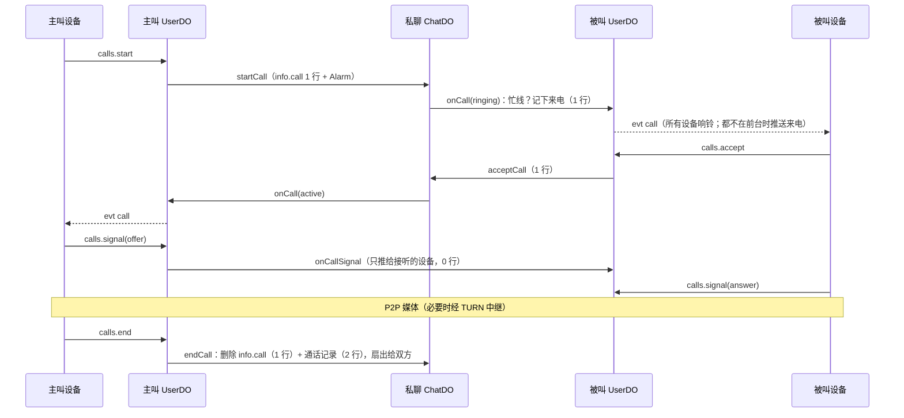
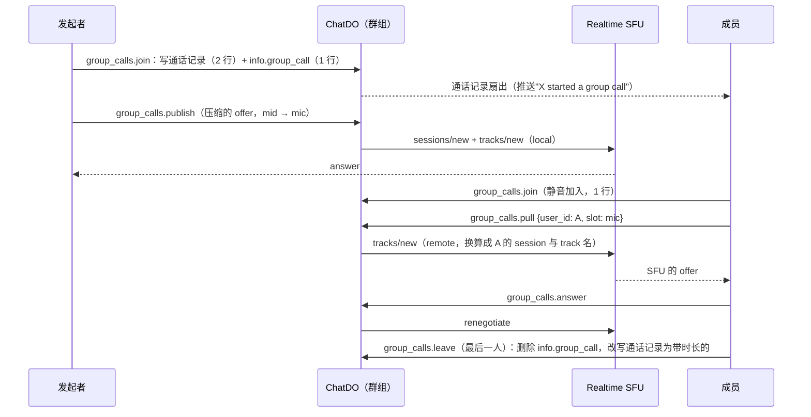

# 04 · 实时与扇出

## 规模前提

- 会话只有两种：**私聊**和**群组**。群组人数上限为 **20 人**（`MAX_GROUP_MEMBERS = 20`），邀请和加入时由 `ChatDO` 校验。
- **暂不做频道和超级群**。因为规模有上限，所有会话都统一采用写扩散，不需要分档。

| 会话 | 新消息成本 | 离线补齐 |
| --- | --- | --- |
| 私聊 | 2 个 DO 请求（ChatDO + 对方 UserDO），4 行写入 | `sync.user` |
| 群组（N ≤ 20 人） | N 个 DO 请求，N + 2 行写入；最坏情况 20 个请求、22 行写入 | `sync.user` |

## 写扩散

- `ChatDO` 发送完成后，**不 await** 扇出，先把结果返回给发送者，然后对每个成员（发送者除外）的 `UserDO` 调用 `onChatEvents(events[])`。
- **批量合并**：扇出期间新到达的事件，按目标用户合并进同一次 RPC。每次 RPC 调用计 1 个请求，合并可以显著降低突发流量下的成本。
- **失败重试**：RPC 失败（对象过载、部署重启等）时，把该用户的事件写入 `fanout_outbox`，由 Alarm 指数退避重试。正常路径不产生这张表的写入。
- **调用深度**：运行时限制调用链的嵌套深度（`Subrequest depth limit exceeded`），而 DO 发出的调用沿用它最近一次入站请求的深度。两个 `UserDO` 经 `ChatDO` 来回投递时深度越积越深，超限后这个对象发出的每个调用都被拒绝，直到收到一个全新的入站请求。`ChatDO` 的扇出失败本来就走 Alarm 重试；`UserDO` 处理客户端请求遇到这个错误时，也立即排一次 Alarm 来重置（只在出错时写 1 行）。这一机制 Cloudflare 没有文档，是根据线上日志与第三方报告推断的。
- 成员 `UserDO` 收到后：upsert dialog（1 行）→ 用 `ctx.getWebSockets()` 推给所有在线设备 → 如果没有**可见**的设备且未静音，发送 Web Push。

## 调用限额

Workers Free 对**每次调用**（包括 DO 的每次请求、RPC、Alarm）有以下限制，来源是 [Workers 限制](https://developers.cloudflare.com/workers/platform/limits/)，核实日期 2026-09-28：

| 限制 | Free | 影响 |
| --- | --- | --- |
| 外部子请求（`fetch` 到公网） | 50 次 | Web Push：单个 `UserDO` 一次推送的设备数远低于此 |
| 内部服务子请求（D1、R2，以及文档中未明确说明的 DO 调用） | 1,000 次 | 一次扇出最多 19 个 RPC，远低于上限 |
| 同时等待响应的连接 | 6 个（超出的排队等待，不会失败） | 扇出使用并发为 6 的池：19 个 RPC 约分 4 轮完成 |

群组人数上限 20 人，这一节的限制都有很大余量。以后如果要做频道或大群，这里会成为约束；届时可以参考 [ADR-0002](../adr/0002-write-fanout-small-groups.md) 中记录的读扩散方案。

## 输入中（Typing）

- 动作分打字（`typing`）与录音（`recording`），随 `presence.typing` 与瞬时事件一起转发。
- 客户端节流：同一会话的同一种动作每 5 秒最多发送一次 `presence.typing`（从打字换成录音时立即发送）；录音没有按键，录音期间每 5 秒重报一次。接收方 6 秒后自动消失，对方发出消息时立即消失。
- `UserDO` → `ChatDO.typing(user_id)` → `ChatDO` 只转发给**正在查看该会话**的用户（`viewers`，保存在内存里）→ 对方 `UserDO` 只推给附件里 `viewing` 包含该会话的设备。
- `viewers` 在 `presence.update` 时登记，60 秒过期，查看期间每 50 秒续订。`ChatDO` 没有长连接，空闲后会被逐出，名单随之清空，而设备的连接仍在，不会立即重新登记。因此实例启动后的第一个续订周期（50 秒）内名单视为不全，输入中改为转给全部成员，由各自的 `UserDO` 按设备的 `viewing` 过滤；此后名单已由续订补齐，只转给查看者。
- 私聊在第一条消息之前也可以登记与转发（`ChatDO` 按 ID 判断身份，不落库）。
- 私聊里任一方拉黑了另一方时不转发。
- 全程不写库。标题栏显示：私聊"typing…"，群组"X is typing…"；都在录音时换成"recording voice…"，有人在打字就写打字。都用 `shimmer` 文字效果。

## 在线状态（Last Seen）

不做"上线就广播给所有联系人"，因为那是 O(联系人数) 的请求风暴。采用**按需观察**：

- **在线** = 至少一台设备的页面可见（包括画中画小窗，见 [07](./07-client.md#画中画)），且心跳未过期（超过 2.5 个心跳周期没有 `ping` 的连接不算，覆盖设备休眠时收不到页面隐藏事件的情况）。一台设备可能开着多个标签页：同步 Worker 汇总后上报，任一标签页可见即设备可见；只有可见标签页打开的会话才算"正在查看"。
- A 打开与 B 的私聊时，A 的 `UserDO` 调用 `B.UserDO.watchPresence(A)`，得到 B 的当前状态。B 的 `UserDO` 把 A 记录为观察者，存在内存中，60 秒后过期；A 在查看期间每 50 秒续订一次。
- B 上线、下线时，只通知当前的观察者。但带着休眠连接的 `UserDO` 空闲约 10 秒就会被逐出内存，观察者名单大多已经丢了，所以**续订的返回值才是状态的主要来源**：状态变化最多滞后约 50 秒。
- **最后上线时间不随切换标签页写库**：每台设备的附件记着最近一次变为不可见的时间（`hidden_at`），最后上线时间取各设备的 `hidden_at` 与落盘值中较晚的；只有最后一条连接断开时才落盘（`UserDO.meta`，1 行）。
- **上线隐私**（设置项 `last_seen`：`everyone` / `nobody`）在 B 的 `UserDO` 内判断。B 选"没有人"，或 A 自己选了"没有人"（对等，A 调用 `watchPresence` 时带上），A 都只拿到大致范围：`recently`（在线或 3 天内）、`week`、`month`、`long`，也看不到在线。大致范围在上线、下线时不会变，所以 B 只通知能看到精确状态的观察者。
- **拉黑**：B 拉黑了 A 时，`watchPresence(A)` 不登记观察者，总是返回 `long`（"很久以前"），不透露任何活跃程度。B 拉黑 A 的那一刻 A 正在观察的话，B 的 `UserDO` 立即推给 A 一次 `long`。

## 已读回执

| 会话 | 我读到哪 | 他人读到哪 |
| --- | --- | --- |
| 私聊 | `UserDO.dialogs.last_read_seq`（多设备同步） | `ChatDO.members.last_read_seq`；前移时扇出给对方（`peer_read` 事件，不占 `chat_pts`），更新对方的 `dialogs.peer_read_seq`。拉黑者的已读照常记录但不扇出，解除后下一次已读带上最新位置 |
| 群组 | 同上 | **暂不展示**：`messages.read` 只写自己的对话行，不请求 `ChatDO` |

客户端对 `messages.read` 节流（每会话每 2 秒最多一次，取窗口内最大的 `seq`）。

- **何时算已读**：消息进入视口且所在窗口可见（`document.visibilityState`；画中画小窗里的 iframe 有自己的 `document`）。客户端先乐观地前移本地的 `last_read_seq`，再节流上报；本地对话行合并服务端数据时对两个已读位置取 `max`，避免尚未确认的已读被旧行拉回。
- **未读数** = `top_seq − last_read_seq`，服务消息计入。打开会话时定位到第一条未读，并显示"未读消息"分隔线，分隔线在本次打开期间不动。贴底阅读（页面在前台、停在最新一条处）时新来的消息不标分隔线，对话列表的徽标与角标也不计这个会话；离开底部或切到后台后来的消息照常标出。
- 以后要展示群组已读回执时，再让群组的 `messages.read` 写 `members` 行、在"最大已读位置"前移时扇出。

## WebSocket 附件

`serializeAttachment` 跨休眠持久存在，但容量很小（约 2KB），只存必要字段：

```ts
type WsAttachment = {
  user_id: string
  device_id: string
  since: number             // 连接建立时间
  visible: boolean          // 任一标签页可见，由 presence.update 上报
  hidden_at: number         // 最近一次变为不可见的时间，用来得出最后上线时间
  viewing: string[]         // 可见标签页正在查看的会话（最多 10 个）
}
```

决定是否发送 Web Push 时，用 `ctx.getWebSockets()` 遍历附件：只要有一台 `visible` 的设备，就不推送。

## Web Push

术语见 CONTEXT.md 的「推送通知」「推送订阅」「通知预览」「角标」。

- **自己实现，不引第三方库**（`server/src/push/webpush.ts`）：VAPID JWT（ES256）与 RFC 8291 `aes128gcm` 载荷加密都用 WebCrypto 完成，加密结果用 RFC 8291 § 5 的示例逐字节校验。每个推送服务（按 origin）的 JWT 缓存在 `UserDO` 内存里，12 小时有效。DO 每次请求有 30 秒 CPU，加密与签名的开销可以忽略。
- **密钥**：公钥是 `shared/protocol` 的常量 `VAPID_PUBLIC_KEY`，浏览器订阅时直接使用；私钥是机密 `VAPID_PRIVATE_KEY`（base64url 的 32 字节 d），开发与生产共用一对。`sub` 固定为 `https://chat.jaze.top`，不暴露个人邮箱。
- **订阅**：属于设备，存在 `UserDO.devices.push`。客户端每次连接都用 `push.set` 上报（`null` 表示不接收），订阅没变时不写库。endpoint 只接受已知推送服务的域名（FCM、Mozilla、Apple、WNS），免得被拿来让 `UserDO` 向任意地址发请求。设备被移除时一并清除。
- **何时推送**：扇出落到 `UserDO` 后，只要有一台设备在前台（沿用在线判定，心跳过期的不算）就不推，否则推给所有订阅了的设备。推送不拖慢扇出：`onChatEvents` 先返回，推送放在 `waitUntil` 里。静音的对话只推提及我（或回复我）的新消息，撤回、编辑的静默替换也不推。
  - 推送的新消息：普通消息、媒体消息，以及把自己拉进群（`chat_create`、`members_add`）、移出群（`member_remove`）的服务消息。
  - 一批事件里每个会话只推一次，取最新的一条。通知的 `tag` 是 `chat_id`，一个会话只保留一条通知；请求带 `Topic`（会话 ID 的哈希），设备离线时推送服务里同一会话只留最新一条。
  - 对话的最后一条消息被撤回或编辑、且仍未读时，推一条 `silent` 通知替换原通知（`Urgency: normal`，不提醒）。只有摘要真的变了（对话行的 `chat_pts` 前移到了这条变更）才替换，所以回应从不推送。已读之后不再推，免得在通知中心里重新冒出来。关闭通知预览时通知里本来就没有正文，不推。
  - 扇出重试的事件（`pts` 不大于对话行原来的 `chat_pts`）不再推送，免得重复提醒。
- **推给谁**：以 D1 中未过期的 session 为准，session 已失效的设备不推并清除订阅；推送服务返回 404 / 410 时也清除订阅。发送者等人的名字在同一次 D1 批量查询里取。
- **载荷**：`PushPayload = {chat_id, seq, title, body, badge, silent}`，文案由 `UserDO` 渲染（与客户端共用 `shared/text`），Service Worker 只负责显示。私聊标题为发送者；群组标题为群名，正文前加"发送者: "。发送者或服务消息涉及的人是有备注名的联系人时，用备注名。关闭通知预览（账号设置 `notification_preview`）时正文只写 "New message"。`badge` 为所有未静音对话（含只读对话）的未读总数。推送在推送服务最多保留 24 小时（`TTL`），新消息 `Urgency: high`。
- Service Worker 不能写本地库（OPFS 同步句柄只属于 Leader 的 Dedicated Worker），应用打开后依靠 `sync.user` 补齐。
- **每次推送的成本**：0 行 DO 写入（订阅失效时 1 行），1 次 D1 批量读取，每台设备 1 个出站子请求。

### 角标

未读总数通过 Badging API（`navigator.setAppBadge`）显示在应用图标上：应用打开时各标签页按本地库计算（与 `UserDO` 的算法一致，不计静音的对话），应用关闭时由 Service Worker 取推送载荷里的 `badge`；设备关着时在别处读过的消息不会让它变小（每次推送都必须显示通知，没有静默推送可以用来更新角标），直到下一次推送或打开应用。Firefox 不支持角标。

标签页的 favicon 跟着变：有未读时为 lucide `message-circle-more`，没有时为 `message-circle`。退出登录与清空本地库时，角标与 favicon 一并复原。

## 通话

术语见 CONTEXT.md 的「通话」「一对一通话」「来电」「忙线」「未接来电」「通话记录」。一对一通话走 P2P、群组通话走 SFU，原因见 [ADR-0009](../adr/0009-p2p-private-calls-sfu-group-calls.md)。群组通话另见「群组通话」。

### 一对一通话



- **状态在私聊的 `ChatDO`**：`info.call` 记下响铃或已接听、两端的设备、期限。`ChatDO` 没有长连接，空闲后会被逐出，所以落盘。第一次联系就打电话时，`ChatDO` 像发第一条消息一样初始化。
- **`UserDO` 的 `meta.call`** 记下自己当前的通话与它所在的设备（来电还在响时为空），用于三件事：忙线判断、信令只转给那台设备、设备断线时通知 `ChatDO`。记下的通话在判断忙线时先向 `ChatDO` 核实，结束通知丢了的顺带清掉。
- **期限与 Alarm**：响铃超时（`RING_TIMEOUT_MS`，30 秒）与断线认领期限（`CALL_GRACE_MS`，30 秒）都是 `info.call` 的 `deadline`，与扇出重试共用一个 Alarm，只在需要更早时才 `setAlarm`；期限提前取消（接听、认领回来）时 Alarm 照样响一次，什么都不做。
- **结果**：接通后挂断是 `ended`，时长从接听算起（断线超时的算到断线的时刻）；响铃中主叫方挂断是 `canceled`，被叫方挂断是 `declined`；超时是 `missed`；被叫方的 `UserDO` 报告忙线是 `busy`。拉黑时进行中的通话随之结束，等同于拉黑者挂断。两人同时呼叫对方时，后到的一方拿到的是对方的来电。
- **通话记录**是 `call` 服务消息，以主叫方的名义写入，`random_id` 由通话 ID 确定性生成，重复结束不会写出第二条。结束可能由被叫方或 Alarm 触发，所以记录扇出给双方，包括主叫方自己。
- **未读**：通话记录在挂断时才写入，不能当成主叫方的发送（否则通话期间对方发来的消息也被算成已读）。除了被叫方的未接来电，它都只在之前的消息都读过时前移已读位置；否则照常计入，免得把更早的未读一起算成已读。未接来电照常计入。
- **最近通话**：通话记录到达双方的 `UserDO` 时各记一条（`calls` 表，见 [02](./02-data-model.md#userdo)），经 `user_pts` 同步到所有设备。
- **推送**：来电在没有前台设备时推送，静音不影响；`ring: true` 让通知一直显示，`TTL` 为响铃时长。通话记录只推送未接来电，并且遵守静音。推过来电通知、而记录不推送时（接听、拒绝、静音的对话里的未接），用记录静默替换掉来电通知（`meta.ring_pushed`），免得"来电"一直留在通知中心里。通知的 tag 都是会话 ID。
- **信令不经过 `ChatDO`**：只有本端通话所在的设备能发，主叫的 `UserDO` 直接交给对方的 `UserDO`，后者只推给它记下的那台设备，并告诉发送方是否送到。没送到时客户端退避重试。不做 trickle ICE：候选收齐（最多等 3 秒）后一次发出 SDP，一次通话的信令通常只有一个 offer 和一个 answer；网络变化时由主叫方重启 ICE，再来一轮。带全部候选的 SDP 只有 STUN 时就约 11 KB（两个视频段的编解码器列表占大头），加上 TURN 的中继候选会超过帧的上限，所以信令在客户端用 `CompressionStream('deflate-raw')` 压缩后以 base64 发送。
- **设备断线**：通话所在设备的 WebSocket 断开时，`UserDO` 通知 `ChatDO`。响铃中主叫方断开即取消。接通后等 `CALL_GRACE_MS`：设备重连后用 `calls.current` 认领回来就继续，否则按断线的时刻结束。等待期间任何一方重新呼叫（比如关掉页面后换个标签页再打），说明已经不回去了：旧通话随即结束，新的照常响铃，免得双方都忙线到期满。P2P 媒体不经过 WebSocket，短暂断线不影响通话本身。
- **ICE 服务器**：`UserDO` 用 TURN key 向 Cloudflare 签发有效期 24 小时的 TURN 凭据，在内存里复用 12 小时；去掉 53 端口的地址（浏览器屏蔽它，不做 trickle ICE 时只会白等到超时）。没有配置 TURN key 时只给 STUN。
- **网络地址**：对方不在我的联系人中时，我这一侧只走 TURN 中继（`iceTransportPolicy: 'relay'`），对方拿不到我的 IP。中继流量计入 Realtime 每月 1,000 GB 的免费出站额度，直连不计。

### 群组通话

房间式：任何当前成员发起，其余成员随时加入、离开，最后一人离开时结束；每个群组同一时间最多一个。媒体经 Cloudflare Realtime SFU，每个参与者一个 SFU session、一个 `RTCPeerConnection`，发布自己的、拉取别人的都在这一个连接上。



- **房间状态**在群组 `ChatDO` 的 `info.group_call`：发起者、开始时间、通话记录的 `seq`、加入过的人，以及每个参与者所在的设备、SFU session、已发布的媒体（`mic` / `camera` / `screen` 各自的 track 名与他那端的 mid）、是否静音、掉线时间。每次变化 1 行写入。
- **SFU 只经 `ChatDO` 操作**：App Secret 只在服务端。客户端只说"拉谁的哪一路"，`ChatDO` 换算成对方的 session 与 track 名，客户端拿不到别人的 session ID。只有参与者所在的那台设备能操作。session 在第一次发布或拉取时才建。
- **静音与开关**：发起者开着麦克风；其余人静音加入，不取麦克风，第一次开麦时才发布。之后静音只把 track 设为 `enabled = false`：SFU 会回收 30 秒收不到媒体的 track，而静音的 track 照样发着静音帧（实测静音 40 秒后再开麦，对方立即收到）。摄像头与屏幕共享关掉时停止发布（`tracks/close`，带停掉收发器后的 offer），再开时以新的 track 名重新发布。静音状态经 `ChatDO` 告诉其他参与者。
- **拉取**：客户端按房间状态拉取所有别人发布的媒体，不再发的就忘掉（发布者关掉后 SFU 已不转发）。实测把订阅端已有的 mid 改指向别人的新 track（`tracks/update`）收不到数据，所以每次都重新拉；收发器随之增加，SDP 跟着变长。
- **Simulcast**：摄像头发三层（`f` 原始、`h` 一半、`q` 四分之一）。宫格拉 `h`，放大的那一路拉 `f`，有放大的画面时其余小窗拉 `q`；屏幕共享只发一层。换层用 `tracks/update`，不需要重新协商。`priorityOrdering` 用 `none`：实测设成 `asciibetical` 时 SFU 按它估计的下行带宽一路降到最低层，换到 `f` 也只收到 `q`；`ridNotAvailable` 用 `asciibetical`，发布者因带宽不够停发某一层时退到下一层。
- **SDP**：客户端发的 offer / answer 压缩后再发（与一对一的信令相同）：拉的路数多了 SDP 会超过帧的上限。实测 4 个 m 段 7.2 KB，压缩后 1.5 KB。SFU 的 SDP 偶尔带着找不到主编码的重传格式（先拉过别人的 H265、再发布时，answer 里有 H265 的 rtx 却没有 H265），浏览器会拒绝整份 SDP，客户端设置之前把这样的 rtx 去掉。
- **通知**：每次变化推给参与者与正在查看这个群组的成员（他们据此显示横条），开关麦克风与摄像头只推给参与者；其余成员只收到通话记录。打开群组时 `presence.update` 顺带返回进行中的通话，事件丢了也能补齐。事件里的 `mine` 告诉一台设备"通话就在你这里"：在另一台设备上加入时，原来那台据此离开。
- **一个人只在一个通话里**：`UserDO` 的 `meta.call` 一对一与群组共用，群组通话里的人被呼叫是忙线，一对一通话中（来电在响也算）加入群组通话也是忙线。
- **离开**：主动离开、退群、被移出、所在设备断线超过 `CALL_GRACE_MS` 都会离开，`ChatDO` 随即关掉他在 SFU 上的所有 track（发布的与拉取的），被移出的人也就收不到媒体了。断线的设备在期限内重连，用 `calls.current` 认领回来；SFU 的媒体不经过 WebSocket，短暂断线不影响通话。客户端的连接坏了（网络切换）时同一台设备重新加入，换一个新的 SFU session，重新发布、重新拉取。WebSocket 由 Leader 标签页的同步 Worker 持有，通话却可能在别的标签页里：那个标签页崩溃或被杀时连接不断，服务端察觉不到。所以通话所在的标签页持有一把 Web Lock，同步 Worker 排队等它，拿到时通话还在本设备上就替它离开（实测关掉标签页后约 0.2 秒离开）。
- **通话记录**是 `group_call` 服务消息，发起时写入"X started a group call"（推送给成员，遵守静音，不响铃）。最后一人离开时同一条改写为带时长的记录，并列出加入过的人；改写不标记为已编辑，成员的 `UserDO` 收到改写时，加入过的人记进最近通话。
