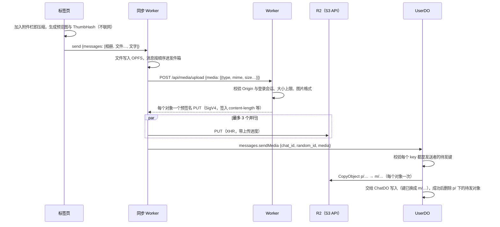

# 05 · 媒体

原则：**重活放在客户端，分发交给 CDN，Worker 只签名。**

术语（媒体消息、相册、视频、文件消息、语音消息、贴纸、我的贴纸、贴纸消息、媒体）见 [CONTEXT.md](../../CONTEXT.md)。

## 消息模型

- 媒体消息不带文字。一次发送里的附件与文字拆成多条消息，按顺序发出：**相册 → 各个文件 → 文字**。
- **相册**：1–10 项图片或视频，可以混排，按加入附件栏的顺序排列。附件栏一次最多 10 项，所以一次发送最多一个相册。视频见下文 [§ 视频](#视频)。
- **文件消息**：恰好一个文件，一次发送多个文件时每个文件各成一条。
- **语音消息**：恰好一段录音，单独发送，见下文 [§ 语音消息](#语音消息)。
- **贴纸消息**：恰好一张贴纸，从我的贴纸里点选后单独发送，见下文 [§ 贴纸](#贴纸)。
- 回复只加在这次发送的第一条上。
- 媒体消息**可以撤回**：2 分钟内，整条撤回，`ChatDO` 同时删除 R2 里的对象（R2 的删除操作免费），已经泄露的地址也随之失效。贴纸除外，见 [§ 贴纸](#贴纸)。
- 媒体消息**可以被回复**，**不能编辑**（没有文字）。
- 不做秒传和去重，每次发送都是独立的对象，所以撤回时可以放心删除。唯一的例外是贴纸：同一张贴纸被所有发过它的消息共用，永不删除（[ADR-0012](../adr/0012-shared-sticker-objects.md)）。
- **转发时复制媒体**：转发者的 `UserDO` 用 R2 的 S3 接口 `CopyObject`（`aws4fetch` 签名）把每个对象复制到转发者名下，字节不经过 Worker，`Content-Type` 等元数据随之复制，每个对象 1 次 A 类操作（一个满的相册 20 次，在子请求上限之内；视频与图片一样复制视频与封面两个对象）。新键的目录由 `random_id` 与原键的哈希派生：重放同一个转发请求写到同样的键，不会多出孤儿对象；`random_id` 只有转发者自己知道，别人猜不出新键。转发出去的是独立的副本，原消息被撤回也不受影响，撤回转发的消息只删自己的副本。复制失败时整个转发失败。转发贴纸消息不复制，照旧引用同一张贴纸。

```ts
type Photo = { type: 'photo'; key: string; preview_key: string; w: number; h: number; size: number; thumbhash: string }
type Video = { type: 'video'; key: string; preview_key: string; w: number; h: number; size: number; duration: number; thumbhash: string }
type MediaFile = { type: 'file'; key: string; name: string; mime: string; size: number }
type Voice = { type: 'voice'; key: string; mime: 'audio/webm' | 'audio/mp4'; size: number; duration: number; waveform: string }
type Sticker = { type: 'sticker'; key: string; mime: 'image/webp' | 'image/png' | 'image/gif'; w: number; h: number; size: number; thumbhash: string }
// 消息体：{ kind: 'media'; media: (Photo | Video)[] /* 1–10 */ | [MediaFile] | [Voice] | [Sticker]; reply_to?: number }
```

- `key` 为大图（GIF 为原图），`preview_key` 为长边 800 的预览图（GIF 取第一帧），`w` / `h` 为大图的尺寸，`thumbhash` 为 base64。
- 视频的 `key` 为 MP4，`preview_key` 为封面（第一帧，长边 800），`w` / `h` 为显示尺寸（已按旋转换算，长边不超过 1280），`duration` 为整秒（至少 1），`thumbhash` 取自封面。
- 对话列表摘要（以及置顶摘要、推送正文）：相册分开计数图片与视频（"Photo" / "3 photos"、"Video (0:42)" / "3 videos"、"2 photos, 1 video"；`MediaSummary` 的 `videos` 与 `duration` 是在原来的 `count` 上加出来的，旧的摘要照样能读），文件消息只给出文件名，语音消息只给出时长（"Voice message (0:12)"），贴纸消息为 "Sticker"，都由 `shared/protocol` 的 `summarizeMedia` 得出。
- 链接预览不是媒体消息，见下文 [§ 链接预览](#链接预览)。

## 上传



- **选择后本地预处理，发送后再上传**：加入附件栏时只在本地处理，不会产生孤儿对象；按下发送后才入发件箱并上传。
- **预签名直传**：文件字节不经过 Worker，不占 Worker CPU 和请求体上限。签名用 `aws4fetch`，一次请求只建一个 `AwsClient`，签名密钥只派生一次。本地实测一次签 20 个地址端到端约 4ms（含开发服务器转发），CPU 时间远低于免费版的 10ms 上限；线上数字部署后以控制台为准。鉴权沿用 `/ws` 的 cookie 缓存校验，不初始化 better-auth。
- **签进签名的 header**：`content-length`、`content-type`、`cache-control`，文件另加 `content-disposition`。客户端改动任何一项（包括多传或少传字节）都会被 R2 拒绝（403 `SignatureDoesNotMatch`，已实测），服务端因此不需要再核对对象大小。有效期 1 小时。
- **只用单个 PUT**，不分片：上限只有 20MB，视频也在本机压到 20MB 以内（见 [§ 视频](#视频)）。失败时整个对象重传。
- **对象键**：上传时为待发键 `{前缀}p/{user_id}/{128bit 随机}/{文件名}`，发送时复制到同一目录的 `{前缀}m/…`（`shared/protocol` 的 `sentKey`），消息里存的是 `m/` 键。见下文 [§ 孤儿对象](#孤儿对象) 与 [ADR-0008](../adr/0008-pending-media-prefix.md)。
  - 图片：`photo.webp|jpg|gif` 与同目录下的 `preview.webp|jpg`；视频：`video.mp4` 与同目录下的封面 `preview.webp|jpg`（不带 `Content-Disposition`，可以在页面里播放）；语音：`voice.webm|m4a`；贴纸：`sticker.webp|png|gif`（添加时复制到 `s/`，见 [§ 贴纸](#贴纸)）；文件：原文件名只保留 `[A-Za-z0-9._-]`，下载时的真实文件名由 `Content-Disposition` 给出。
  - **上传者 ID 写在键里**：`messages.sendMedia`、带卡片图片的 `messages.send` 与 `DELETE /api/media` 都用正则完整匹配 `{前缀}p/{自己的 user_id}/…`。否则 A 可以伪造一条引用 B 的 key 的媒体消息，再撤回，借此删掉 B 的图。只接受待发键还保证每个对象只属于一条消息（撤回一条不会删掉另一条的媒体），`DELETE /api/media` 也删不了已发送的媒体。
  - 前缀：生产环境为空，开发环境为 `dev/`（`MEDIA_KEY_PREFIX`）。
- **上限**：图片原图、转码后的视频与文件一律 20MB，语音 8MB；视频只接受 `video/mp4`；图片格式只接受 `image/webp`、`image/jpeg`、`image/gif`（预览图只接受前两种），录音只接受 `audio/webm`、`audio/mp4`（不带 codecs 参数）；贴纸 2MB，只接受 `image/webp`、`image/png`、`image/gif`。
- **发件箱**：
  - 同一会话严格按入队顺序逐条发送，媒体没传完之前，后面的文字也要等。
  - 某条失败（签名被拒、R2 拒绝、WebSocket 在线但 R2 不可达）时标记为发送失败，留在原位可以重试或删除，后面的消息照常发送。
  - 断线时停下，重连后接着传；刷新或换 Leader 后也接着传。每传完一个对象就记下它的 key，已传完的不会重传。

## 客户端处理

| 类型 | 处理 |
| --- | --- |
| 图片 | `createImageBitmap` → `OffscreenCanvas` 缩放：大图长边 2560，预览图长边 800，编码为 WebP；浏览器不支持编码 WebP 时（Safari）退回 JPEG，并先铺白底。ThumbHash 由 100×100 以内的缩略图算出，约 25 字节，内联进消息 |
| GIF | 原样上传，保留动画；预览图取第一帧。气泡里直接显示原图，才能播放动画 |
| 文件 | 原样上传，不做预览 |
| 视频 | mediabunny（WebCodecs）在 Web Worker 里转码为 H.264/AAC MP4（长边 1280），本来就合格的只重新封装；第一帧作为封面。见 [§ 视频](#视频) |
| 语音 | `MediaRecorder` 录 Opus（WebM），不支持时退回 MP4；录完解码整段录音得出时长与 64 点波形，内联进消息。见 [§ 语音消息](#语音消息) |
| 链接预览卡片的图片 | 长边 800 的 WebP（Safari 为 JPEG）与 ThumbHash，只有一个对象，见 [§ 链接预览](#链接预览) |

- **入口**：输入框左侧的加号菜单分"图片与视频"（Photo or Video）与"文件"两个入口。图片与视频入口压缩、转码后进相册，文件入口原样发送。粘贴、拖拽与系统分享面板进来的 `video/*` 按视频处理。
- **粘贴与拖拽**：浏览器能解码的位图（JPEG / PNG / WebP / AVIF / BMP，以及能解码的 HEIC）和 GIF 按图片处理，其余按文件处理。从图片入口选到浏览器解码不了的图（例如 Chrome 里的 HEIC），自动改为按文件发送。
- **待上传的文件暂存在 OPFS** 的 `outbox/{random_id}/` 下（`m{i}` 为大图或文件，`p{i}` 为预览图），由发件箱条目引用。发送成功或删除这条消息后清理；启动时清掉没有对应发件箱条目的目录；退出登录时整个删除。
- 上传完成之前，发送方从 OPFS 读出本地文件显示。发送中显示进度：图片上盖一层模糊蒙层（`app-blur`），进度条在图上；文件卡片把大小换成进度条。还没开始上传或等服务端确认时为不定进度，发送失败的不显示。

之所以不用 Cloudflare Images 做缩略图：免费额度只有 5,000 次唯一转换/月，每张新图至少要一次转换，很快就会用完。

## 链接预览

术语见 [CONTEXT.md](../../CONTEXT.md) 的"链接预览"。纯链接的文本消息（正文去掉首尾空白后恰好是一个 http(s) 链接，判断规则在 `shared/text` 的 `linkOnly`，输入框、服务端与显示共用）可以带一张卡片，由**发送方**在发送前生成，跟着消息一起发出，接收方从不访问那个网站。

```ts
type LinkPhoto = { key: string; w: number; h: number; thumbhash: string }
type LinkPreview =
  | { type: 'web'; title: string | null; photo?: LinkPhoto }      // 都没有：抓不到，或者是 http 链接
  | { type: 'invite'; title: string; member_count: number }      // 本站的邀请链接：发送时的群名与人数
// 文本消息体：{ kind: 'text'; text; …; preview?: LinkPreview }，没有卡片时不出现
```

- **抓取**：发送方停止输入 400ms 后，标签页请求 `POST /api/link-preview {url}`。Worker 只抓 `https:` 与默认端口；拒绝 IP 字面量、`localhost` / `.local` / `.internal` 等保留域名、单段主机名和应用自己的域名（含媒体子域名）；重定向手动跟随最多 3 跳，每一跳重新检查；单次请求 4 秒超时；只读网页开头 256 KB，`</head>` 之后不再读。HTMLRewriter 抽取 `og:title`（其次 `twitter:title`、`<title>`）与 `og:image`（其次 `twitter:image`，按最终地址解析成绝对地址，只保留 https），按 Content-Type 里的 charset 解码。结果按链接（去掉 `#` 片段）放进 Cache API：抽到标题或图片的保留 1 天，拿到了网页却什么都没抽到的保留 1 小时；超时、网络错误、对方返回错误状态（例如 429、503）不缓存，免得一次临时失败让所有人一小时内都只看到域名。
- **图片**：标签页再请求 `POST /api/link-preview/image {url}`，Worker 取回图片（同样的地址检查，只接受 JPEG / PNG / WebP / GIF / AVIF，原图上限 5 MB），响应带 `X-Content-Type-Options: nosniff` 与 `Content-Security-Policy: sandbox`，从不在本站直接显示。标签页压缩成长边 800 的预览图并算出 ThumbHash；发送时像普通图片一样预签名直传 R2，再在发送时复制到 `m/`（上传请求的 `type: 'link'`，键为 `…/link.webp|jpg`，2 次 A 类操作）。接收方从媒体域名读取，不会把 IP 暴露给第三方网站，也不怕原图失效或防盗链。
- **邀请链接**的卡片不经过 Worker：标签页用 `chats.checkInvite` 拿到群名与人数（发送方是成员才拿得到链接）。
- **输入框**：像回复栏一样在上方显示一条预览（小图、标题与域名，抓取中显示转圈），点 ✕ 这次不带卡片，按普通链接发出。编辑消息时不显示。
- **发件箱**：卡片状态记在发件箱的 `link` 列里，卡片图片暂存在 `outbox/{random_id}/l`。按下发送时还没抓到的记为 `pending`，由同步 Worker 在发送前自己抓取，最多等 5 秒；抓不到就发成只有域名的卡片（`{type: 'web', title: null}`），图片传不上去就不带图，都不会让这条消息发送失败。每一步的结果写回发件箱，刷新或换 Leader 后接着来。
- **服务端校验**（`messages.send`）：带卡片的正文必须是纯链接；`invite` 卡片的链接必须是本站的 `/join/{邀请码}`；卡片图片的键必须属于发送者（与 `sendMedia` 相同，否则可以借撤回删掉别人的对象）；标题最长 300 个字符。卡片记在 `ChatDO.messages.preview`，不多花写入。
- **编辑**：去掉首尾空白后链接没变则保留卡片，否则去掉卡片并删除它的图片，不重新抓取。**撤回**时卡片图片一并删除。**转发**时卡片照搬，图片像媒体一样复制到转发者名下。
- **显示**：iMessage 样式，卡片自己有底色，不套气泡。有图时大图在上（宽高比限制在 1:1 到 2:1）、标题与域名在下；没图时左边是链接图标；邀请卡片是群头像、群名与人数。卡片上的**域名总是在显示时从正文里的链接算出**（非 ASCII 域名保持 punycode），点击打开的**总是正文里的链接**，所以改过的客户端最多伪造标题与图片，伪造不了域名与去向；只有链接确实是本站的邀请链接时才显示成邀请卡片。本站链接在应用内跳转，其他链接在新标签页打开，带 `rel="noopener noreferrer"`。
- **夹在文字中间的链接**只是可点击的文字，没有卡片；结尾的标点不算进链接，提及覆盖的部分不识别。
- **搜索**：本地搜索把卡片标题与正文一起索引。
- **本地开发**（2026-10-08 观察）：本地开发服务器里，developers.cloudflare.com 能抓到标题与图片，github.com 与 bbc.com 在 4 秒内连响应头都没有收到，卡片退化为只有域名，而同一台机器上的 curl 经代理不到 1 秒。原因推测是本地 workerd 的出站请求没有走系统代理，**待验证**；线上抓取这些网站的表现也**待实测**。

## 视频

术语见 [CONTEXT.md](../../CONTEXT.md) 的"相册""视频"。代码在 `web/src/features/media/` 的 `video.ts`（标签页）、`video-worker.ts`（Web Worker）与 `video-plan.ts`（怎么处理，可以单独测试）。

**处理**（加入附件栏时开始，转完才能发送）

- 每个视频开一个 Web Worker，按加入的顺序一个一个处理；从附件栏删掉这一项时直接结束它的 Worker。mediabunny 只在 Worker 里引入，不进主包。
- 先读轨道、时长与帧率（取开头 60 帧估计），由 `planVideo` 决定：
  - **只重新封装**：已经是 H.264（音轨为 AAC 或没有音轨）、长边不超过 1280、帧率不超过 30、原文件不超过 20MB。不损画质，只要几十毫秒。
  - **重新编码**：其余的转成 H.264/AAC，长边缩到 1280（宽高取偶数，H.264 编码器不接受奇数），帧率超过 30 的降到 30；音频 96kbps，最多 2 声道，采样率不是 44.1/48kHz 的重采样到 48kHz。视频码率按时长分配：90% 的大小上限除以时长再减去音频，最高 2Mbps、最低 0.7Mbps。约 1 分钟以内是满画质，最长约 3 分钟。
  - **太长**：分到的码率低于 0.7Mbps。
- 两种都清掉原文件的元数据（拍摄位置、设备等），并把索引放在文件头（fast start），接收方可以边下边播。
- 旋转：只重新封装时保留文件里的旋转信息，重新编码时把旋转画进画面；`w` / `h` 一律是显示尺寸。
- 只转主视频轨与主音轨，其余轨道（第二条音轨、字幕等）直接不要；这两条里任何一条被丢掉（解码或编码不了）都算处理不了，免得发出没有声音的视频。
- 转完超过 20MB 算太长。编码器在正常画面上能守住码率（2026-10-08 实测，目标 1Mbps：平滑纹理平移、移动图形在硬件与软件编码下都在 1% 以内，恒定与可变码率没有区别），但像素级的随机噪点几乎压不动，硬件编码器约超出 4 倍、软件约 7 倍；这类极端画面转完才会发现太长。
- **处理不了或太长**：原文件不超过 20MB 时改为按文件发送，否则从附件栏移除并提示。
- **AAC**：浏览器没有原生 AAC 编码器（例如 Firefox）时，Worker 动态加载 `@mediabunny/aac-encoder`（WASM，约 1MB），其他浏览器不下载。它不进 Service Worker 的预缓存清单，用到时才从网络取。
- **封面**：第一帧按旋转摆正，压缩成长边 800 的 WebP（Safari 为 JPEG），算出 ThumbHash，与图片的预览图走同一套编码。
- 附件栏里转码中显示 Progress，转完显示封面与时长。

**实测**（2026-10-08，无头 Chrome，构建后的产物）：1920×1080 60fps → 1280×720 30fps；640×360 H.264/AAC 只重新封装（39ms）；带 90° 旋转元数据的视频尺寸与封面方向正确；VP9/Opus 的 WebM、没有音轨的、奇数尺寸（1001×563 → 1002×564）都能转；220 秒的判为太长；中止有效；WASM AAC 编码器能加载并编码。端到端（本地开发服务器 + 真实的 R2）：发送、对话摘要、查看器播放（R2 返回 206 Range）、之后的下载 `fetch` 都正常。

**发送**：与图片一样，视频与封面两个对象一次签发、预签名直传，发送时复制到 `m/`，4 次 A 类操作。撤回删除两个对象，转发复制两个对象。

**显示与播放**

- 相册网格里视频显示封面，左下角是播放图标与时长（Badge 的 `overlay` variant）。不带 `data-photo`，消息右键菜单不会出现"复制图片"。
- 点开在同一个全屏查看器里播放：打开即有声播放，不循环，切到别的项或关闭时停止；开始播放时暂停正在播的语音消息（播放条保留）。有下载，没有复制。在视频上按下的不算滑动（拖进度条），方向键留给视频控件。
- `<video crossOrigin="anonymous">`：与图片一样以 CORS 方式加载，否则浏览器缓存里不带 CORS 头的响应会让之后的下载失败（见 [§ 分发](#分发)）。不用 `poster`：它不走 CORS 与 no-referrer，封面改为垫在视频下面的 ``。
- `<video>` 不能设置 `referrerPolicy`，播放视频时会带上 Referer（例外于"媒体请求一律不带 Referer"）。`.mp4` 不在防盗链的范围内，开发环境的 `localhost` 也能播。
- 视频不进媒体缓存，Service Worker 对视频地址（键以 `video.mp4` 结尾）不调用 `respondWith`，由浏览器直接发 Range 请求边下边播；离线时只看得到封面。

**待真机实测**：Safari 与 Firefox 上的转码（含 Firefox 的 WASM AAC）、iPhone 拍的 HEVC / HDR 视频（Chrome 能否解码、HDR 转 SDR 的颜色）、手机上转一段 3 分钟视频的耗时与发热、iOS 上 CORS 方式的 Range 播放。

## 语音消息

术语见 [CONTEXT.md](../../CONTEXT.md) 的"语音消息""未听""播放条"。代码在 `web/src/features/voice/`。

**录音**（`recorder.ts`）

- 输入框为空且没有附件时，发送按钮换成麦克风；点一下开始录，录音条（`record-bar.tsx`）取代输入框：左边删除，右边发送，中间是计时与实时波形（`AnalyserNode` 每 100ms 取一次音量）。开始录音时暂停正在播放的语音。
- 格式：依次尝试 `audio/webm;codecs=opus`、`audio/webm`、`audio/mp4`。Chrome、Firefox 与 Safari 18.4+ 都能录 WebM/Opus，旧版 Safari 退回 MP4（AAC）。不选 AAC：Chrome 能录 `audio/mp4;codecs=mp4a.40.2`，但自己录的文件放不出来（2026-10-08 无头 Chrome 154 实测，Format error）。码率 32kbps，Chrome 实测约 4KB/s，5 分钟约 1.3MB；Safari 录 AAC 时可能不理会码率，上限因此放宽到 8MB（`MAX_VOICE_BYTES`）。
- 每秒交出一个分片（`start(1000)`）：被打断时已经交出的部分不会丢。
- **时长与波形**：录完后用 `OfflineAudioContext`（8kHz）解码整段录音，时长取解码结果，波形取每 100ms 一段的音量，再压缩成 64 段峰值、按最大值归一化成 0–255（base64，88 个字符）。不靠录音期间的计时：页面在后台时定时器会被节流，WebM 文件本身又不带时长（`<audio>.duration` 为 Infinity）。解码失败时才退回录音期间的计时与实时音量。Chrome 实测解码 3.5 秒的录音得到 3.48 秒，只取前两个分片也能解码（1.98 秒）。时长取整秒、限制在 1–300，服务端按此校验。
- 用设置里选定的麦克风与 AI 降噪（见 [07 § 通话](./07-client.md#通话)）；录音中途不跟着换设备。
- 录满 5 分钟自动结束并发送；不到 1 秒丢弃。结束、删除、被打断时都停止所有音轨，浏览器的录音指示随之消失。
- **被系统打断**：麦克风的音轨 `ended` / `mute`（含麦克风被拔掉） 或录音器 `error` 时停下，录音条显示"Recording stopped"与已录的时长，等用户发送或删除；什么都没录到时提示后回到输入框。手机切到别的应用、锁屏、来电时的实际表现**待真机实测**。
- **离开会话**：录音时（含被打断后等待选择）切到别的页面，先弹 AlertDialog 确认丢弃（TanStack Router `useBlocker`，只拦路径变化）；刷新或关闭页面由浏览器的 `beforeunload` 询问。
- 回复目标照常带上：录音条上方显示回复条，发出的语音消息就是那条回复。
- 输入中：录音期间以 `recording` 动作上报 `presence.typing`，没有按键，所以每 5 秒重报一次。
- 画中画小窗的 iframe 带 `allow="microphone"`，小窗里也能录。

**发送**：与文件消息走同一条发件箱：录音暂存在 OPFS 的 `outbox/{random_id}/m0`，上传请求为 `{type: 'voice', mime, size}`，签发一个对象（不带 `Content-Disposition`，可以在页面里播放），上传与发送时的复制共 2 次 A 类操作。服务端校验 `mime`、`size`、`duration`（整数 1–300）与 `waveform`（64 字节）。撤回删除录音，转发复制录音一个对象。

**播放**（`player.ts`、`voice-message.tsx`）

- 每个页面一个全局 `<audio>`（画中画小窗是独立的页面，有自己的一个）。点播放时先 `fetch` 整个录音（经 Service Worker 的媒体缓存，听过的离线也能播），再用 object URL 播放；内存里留最近 4 个。WebM 没有时长也能在 Blob 上跳转（Chrome 实测），进度一律以消息里的 `duration` 为准。
- 自动播放：iOS Safari 只允许用户点击里开始播放。点击时先让这个 `<audio>` 播一段静音解锁，之后取回录音再播、播完自动接着播下一条都用同一个元素。**待真机实测**。
- 同一时间只播一条：开始播放时经 BroadcastChannel `web-chat-voice` 通知，其他标签页与小窗随即暂停。
- 倍速 1× / 1.5× / 2×，存在本机 `localStorage`（`voice-rate`），对之后所有语音生效；变速不变调（浏览器默认 `preservesPitch`）。
- 气泡：语音消息像文本一样套气泡，左边播放按钮，右边波形与时长；正在播放器里的那条显示进度，可以在波形上拖动（Slider 的 `overlay` variant 透明地盖在波形上）。未听的带一个小圆点。
- **未听**：只记在本地库的 `played` 表，零服务端写入。开始播放时记为已听；本地库建立的时间记在 `kv.created_at`，在这之前发来的语音不算未听，新设备上历史语音不会满屏圆点。查询在 `unplayed.ts`。
- **连播**：播完一条，接着播同一会话里 seq 更大的第一条未听语音（中间隔着文字也接着播），没有了就停下并收起播放条。
- **播放条**（`player-bar.tsx`）：放在每个页面标题栏中间的剩余空间里（会话、群组信息、资料页、首页、邀请页、分享页、画中画），手机上的对话列表顶栏也有。用 container query 判断：放得下（≥ 20rem）时显示完整控件，否则只留一个带进度环的按钮，点开 Popover 显示完整控件。点发送者的名字定位回那条消息（画中画里不跳转）。正在播的语音被撤回时停止。

**待真机实测**：iOS / Android 切到后台、锁屏、来电时录音能否保留已录部分；Safari 能否播放 Chrome / Firefox 录的 WebM；iOS 静音解锁后的连播；Safari 录 AAC 的实际码率；画中画小窗里录音。

## 显示

- 相册与文件消息都不套气泡（Bubble 的 `ghost` variant）。相册：1 项按原始比例显示（宽高比限制在 1:2 到 2:1 之间，超出的裁切），2–10 项分成每行 2–3 项、铺满宽度的几行，项数除不尽时 3 项的行排在后面，最后一行不会只剩一张（与 3 项的行混排时，2 项的格子为 3:2，各行一样高）。先用 ThumbHash 占位，再加载预览图（视频为封面）。视频的显示与播放见 [§ 视频](#视频)。
- 点开是全屏查看器：打开与关闭用 View Transition 让图片在缩略图与全屏之间移动（两端宽高比不同时按 cover 裁切，圆角同步过渡；偏好减少动效时直接切换）。在本相册内左右切换（按钮、方向键、滑动），轻点图片以外的地方关闭，可以复制与下载；复制时取回后转成 PNG 写入剪贴板（GIF 只剩第一帧），消息右键菜单也能复制按下的那张。下载时先取回 Blob 再保存，因为 `<a download>` 对跨域地址无效。在整个会话的所有图片之间切换，留到"共享媒体"面板再做。
- 文件消息显示文件名与大小，点击即下载。

## 贴纸

术语见 [CONTEXT.md](../../CONTEXT.md) 的贴纸、我的贴纸与贴纸消息。存放方式见 [ADR-0012](../adr/0012-shared-sticker-objects.md)。

- **对象**：`{前缀}s/{user_id}/{随机}/sticker.webp|png|gif`，只有一个对象（没有预览图），消息与收藏里都带宽高与 ThumbHash。`s/` 下的对象**从不删除**：发送、转发、别人从贴纸消息添加，都引用同一个对象；撤回贴纸消息、从我的贴纸移除都不删它。存储因此只随"添加"增长，与发送次数无关。
- **从图片添加**（会话里的图片：消息右键菜单按下的那张、查看器的按钮；或在面板里从本机选图）：标签页取回图片，在本机处理（`features/stickers/prepare.ts`）：
  - 静态图缩到长边 512 以内（不放大），编码为 WebP；浏览器编不了 WebP 时（Safari）`convertToBlob` 按规范退回 PNG，两者都保留透明，不铺白底。
  - GIF 原样保留动画，尺寸不变。
  - 处理后超过 2MB（`MAX_STICKER_BYTES`）的不能添加。
  - 同步 Worker 以上传类型 `sticker` 申请签名、传到待发区，再调用 `stickers.add {from: 'upload', key, w, h, size, thumbhash}`。`UserDO` 校验键是自己的待发键，格式由文件名决定（不信客户端），静态图长边不超过 512；先查上限再复制到同一目录的 `s/`（`savedKey`），写入收藏行后删除待发对象。重放时待发对象已经删了、`s/` 还在，照常成功；都不在时返回 `media_expired`。
- **从贴纸消息添加**：`stickers.add {from: 'message', chat_id, seq}`，`UserDO` 经 `ChatDO` 确认这条消息读得到、确实是贴纸消息，直接把它的键记进收藏，不上传、不复制。已经在收藏里的什么都不做；移除过的复活并排到最前。
- **上限**：我的贴纸最多 200 张（`MAX_STICKERS`，不含墓碑），满了返回 `sticker_limit`。标签页在处理与上传之前先查本地的数量。
- **发送**：普通会话里 `messages.sendSticker {chat_id, random_id, key, reply_to?}`。`UserDO` 只接受自己收藏里（未移除）的键，格式、宽高、ThumbHash 都取自收藏行，然后交给 `ChatDO` 写一条贴纸消息，**不经过 R2**。发件箱里的贴纸记着它在我的贴纸里的键（`source`），确认时本地写的就是这个键。贴纸消息不清空草稿：点选贴纸不动输入框里的文字。
- **秘密聊天**：同步 Worker 入队时取回贴纸，暂存进 OPFS，之后像其他媒体一样加密上传到 `m/`（每发一次一份，撤回时删除）。密文里的贴纸带格式、宽高与 ThumbHash。秘密聊天里的图片与贴纸都不能添加到我的贴纸，免得它们以明文出现在 `s/`。
- **显示**：会话里没有气泡，长边 160px，透明处透出背景，GIF 自动循环播放。点开是原尺寸的预览（长边最大 512，窄屏上按比例缩到可用宽度），可以添加到我的贴纸，已经在收藏里的按钮显示为已添加；秘密聊天里只有预览。回复引用里带一张小缩略图。贴纸消息不进搜索索引。
- **面板**：输入框的「+」菜单里的 Sticker 打开（编辑消息时没有这一项），桌面是贴着输入框上方弹出的 Popover，手机是 Drawer；只在点外面、按 Esc（Drawer 还有下拉）与发出贴纸时关闭（焦点离开、点移除贴纸的右键菜单都不关）。网格按添加时间倒序，点一张立即单独发出（带上正在回复的消息），面板关闭；右键或长按一张可以移除。Add Sticker 从本机选一张图片。

## 秘密聊天的媒体

R2 里只有密文，见 [06 § 端到端加密](./06-auth-and-security.md#端到端加密)。

- **加密**：每个媒体一把 AES-256-GCM 密钥（大图与预览图共用，nonce 各自随机），在同步 Worker 里上传前加密：nonce（12 字节）| 密文，比原文件多 28 字节（`SEALED_MEDIA_OVERHEAD`）。附加数据写明用途（大图或预览图），存储不能把两者对调。密钥在上传之前生成并存进发件箱，重启后续传的部分用同一把；`media_expired` 时照常重新上传。
- **上传**：申请预签名时类型为 `sealed`，只给加密后的大小（上限 `MAX_MEDIA_BYTES + 28`），键名为 `sealed.bin` / `preview.bin`（`.bin` 在 CDN 默认缓存的扩展名之列），`Content-Type` 为 `application/octet-stream`，不带 `Content-Disposition`，服务端看不出是图片、视频、文件还是录音，也不知道文件名。
- **发送**：消息内容（加密的）里带发送后的键、密钥与原有的媒体字段（图片另带格式，键名里看不出来）；`secrets.send` 的 `keys` 只给待发键，服务端照常复制到发送后的键，撤回与删除时据此删除。解开的内容按协议校验，不合格的（例如键不是发送后的键）当作验证失败。
- **显示**：在标签页里取回密文、解开，交给 ``、`<video>`、下载与播放器的是 object URL（`features/secret/sealed-media.ts`）。气泡里的预览图（GIF 还有原图）随显示解开，解开前是 ThumbHash 占位；大图与视频打开查看器时才解开，文件点击下载时、录音播放时才解开。解开的 Blob 按对象键缓存在内存里（最多 64MB，按最近使用淘汰），object URL 由每个使用者各自创建、卸载时回收。密文经浏览器的 HTTP 缓存（对象不变），**解开的内容不落盘**，也不进 Service Worker 的媒体缓存。秘密聊天里的图片不能从消息右键菜单复制（查看器里可以）。

## 分发

- 桶 `web-chat-media` 绑定自定义域名 `r2.chat.jaze.top`，公开读取。请求直接命中 Cloudflare CDN，**不调用 Worker，不消耗 Worker 请求额度**，出站流量也免费。
- 对象上传时就带着 `Cache-Control: public, max-age=31536000, immutable`，因为对象写入后永不修改（改动即新键）。不需要额外的 Cache Rules。
- **删除会让 CDN 缓存失效**（2026-09-29 从单个节点实测）：图片先被缓存（`cf-cache-status: HIT`），删除对象后同一节点立即返回 404（MISS）。其他节点未验证。撤回"让已泄露的地址失效"依赖这一点。
- **CORS 与缓存**：CDN 把带 `Origin` 的请求与不带的分开缓存，但不带 `Origin` 的响应里没有 `Vary: Origin`。浏览器缓存因此会把 `` 以 no-cors 方式取回的图（没有 `Access-Control-Allow-Origin`）交给之后的 `fetch`，查看器的下载就会失败（已实测）。所以媒体图片一律以 CORS 方式加载（``），这也让以后 Service Worker 缓存的是普通响应而不是不透明响应（Chrome 把每条不透明响应按约 7MB 计入配额）。
- **防盗链**：jaze.top 区域开着 Scrape Shield 的防盗链，Referer 不是本站域名时 `.gif` / `.jpg` / `.png` 返回 403（`.webp` 不受影响）。线上的 `chat.jaze.top` 可以通过，开发环境的 `localhost` 不行。媒体请求因此一律不带 Referer（`referrerPolicy="no-referrer"`，下载链接 `rel="noreferrer"`）（视频是例外，见 [§ 视频](#视频)），开发与线上行为一致，也不必把会话地址发给 CDN。
- 媒体使用独立的子域名，与应用 Origin 隔离。文件一律带 `Content-Disposition: attachment`，HTML / SVG 等也不会在浏览器里直接打开。
- **待办**：`X-Content-Type-Options: nosniff` 要在 jaze.top 区域加一条响应头改写规则（Transform Rule），尚未配置，做法见 [09 § 待办（配置）](./09-roadmap.md#待办配置)。
- 消息里只存对象键，客户端拼上媒体域名（`web/src/features/media/media-url.ts`）得到地址。

**权衡**：这里的访问控制是"持有键即可访问"（capability URL），与 Telegram 的公开 CDN 文件模型类似。需要更强保密性的内容走第三阶段的秘密聊天：媒体在客户端加密后再上传，R2 里只有密文。

## 桶的配置

开发与生产共用一个桶，开发环境上传的对象都在 `dev/` 下。

| 配置 | 值 |
| --- | --- |
| CORS | `http://localhost:5173`、`https://chat.jaze.top` 可以 `GET` / `PUT`；允许的请求头：`content-type`、`content-disposition`、`cache-control` |
| 生命周期 | `pending-expire`：`p/` 下的对象 7 天后删除（生产环境的孤儿清理，见 [§ 孤儿对象](#孤儿对象)；贴纸所在的 `s/` 不受影响，生产环境的贴纸从不删除）；`dev-expire`：`dev/` 下的对象 30 天后删除（已覆盖开发环境的 `dev/p/`）；未完成的 multipart 上传 1 天后中止 |
| 自定义域名 | `r2.chat.jaze.top`（最低 TLS 1.2） |
| S3 API 令牌 | Object Read & Write，只限这个桶；填入 `R2_ACCESS_KEY_ID` / `R2_SECRET_ACCESS_KEY` |

- CORS 列表同时决定能不能**看到**图片：媒体 `` 以 CORS 方式加载，不在列表里的 Origin（局域网 IP、`vite preview` 的其他端口、`*.workers.dev`）上传会失败，图片也显示不出来。换地址访问时先把它加进 CORS。
- Worker 的 R2 绑定 `MEDIA` 用于删除对象（撤回、发送后删除待发对象、`DELETE /api/media`）。本地开发时这个绑定是模拟的，删除只作用于本地；预签名上传、发送与转发时的复制、复制前的 HEAD 都走 S3 接口，直达真实的桶。开发环境留下的对象由生命周期规则清理，`dev/s/` 下的贴纸 30 天后也会被删掉，之后在开发环境里显示为坏图（发送贴纸不检查对象是否存在）。
- 测试不连真实的 R2：只校验签发的地址；发送与转发时的复制、HEAD 与删除都作用于本地模拟的桶。

## 孤儿对象

不会出现消息引用了不存在的对象：消息总是在所有对象都传完、并复制到 `m/` 之后才写入。孤儿只来自"传完了却没发出去"，没有定时任务，靠两段前缀与桶的生命周期规则（[ADR-0008](../adr/0008-pending-media-prefix.md)）：

- **待发区**：上传写到 `p/`，发送时 `UserDO` 复制到 `m/`，`ChatDO` 写入成功后删除 `p/` 下的原件（尽力删除，删不掉的照样会过期）。没发出去的（设备在其他设备上被移除、崩溃、伪造的只上传不发送）留在 `p/`，由生命周期规则 `pending-expire` 在 7 天后删除。
- 用户删除一条发送失败的消息、退出登录：客户端趁会话还有效调用 `DELETE /api/media`，当场删除发件箱里已上传的待发对象。
- **待发对象过期**：发件箱离线放了超过 7 天，发送时找不到 `p/` 下的原件。此时先 HEAD 对应的 `m/`：在，说明之前已经复制并写入过、只是确认丢了，照常交给 `ChatDO` 去重；不在，返回 `media_expired`，同步 Worker 清掉这条的对象键、从 OPFS 重新上传后再发一次，再失败才标为发送失败。只有"对象不存在"算过期，其他复制失败（5xx、403）照常是发送失败。
- **复制出来却没写入的**：复制到一半失败，或者 `ChatDO` 拒绝（例如对方拉黑了自己），`UserDO` 当场删掉这次复制出来的 `m/` 对象，`p/` 下的原件留给删除失败消息或生命周期规则。`ChatDO.send` 先去重、再校验成员与拉黑，所以被拒绝一定说明没有写入，删掉不会误伤已经发出的消息。发送前先在 `UserDO` 判断自己是否拉黑了私聊对象，不复制就拒绝。转发同样处理：复制失败或被拒绝时删掉复制出来的副本。
- **只记日志的**：撤回、编辑去掉卡片时 `ChatDO` 删除失败的对象，以及上面"当场删掉"又删失败的副本。它们在 `m/` 下，生命周期规则管不到；都很少见，只占存储。
- 链接预览卡片的图片与媒体走同一套流程。
- **贴纸**：添加时同样先进待发区。被移除、不再有消息引用的 `s/` 对象成为永久残留，只占存储，目前不清理（[ADR-0012](../adr/0012-shared-sticker-objects.md)）。

## 客户端缓存

- Service Worker 拦截 `r2.chat.jaze.top` 的请求，缓存优先。只把图片（`` 发出的请求，即预览图、大图与视频的封面）与语音消息的录音（键以 `voice.webm|m4a` 结尾，播放器整个取回）写进 Cache Storage 的 `media`；文件下载走网络，不占缓存；视频不经过 Service Worker（见 [§ 视频](#视频)）。图片以 CORS 方式加载，缓存的是普通响应，离线时下载已缓存的图片也能直接用。
- **按最近使用淘汰**：索引（每张图的大小与最近使用时间）和上限存在 IndexedDB `media-cache` 里，而不是本地 SQLite，因为 SW 用不了 OPFS 上的库。最近使用时间最多每小时更新一次；存入新图后超过上限时，从最久没用的开始删，直到上限的 90%。逻辑在 `features/media/cache.ts`，SW 与标签页共用。
- **本机设置**（设置 → Storage，不同步）：上限默认 1 GB，可选 256 MB / 1 GB / 4 GB / 不限（不限时仍受浏览器配额约束）；显示用量，可以一键清除。退出登录、清空本地库时一并清除，上限保留。
- 启动时调用 `navigator.storage.persist()` 申请持久存储。

## 免费额度影响

| 资源 | 免费额度 | 消耗方式 |
| --- | --- | --- |
| R2 存储 | 10 GB-月 | 主要瓶颈。单个媒体上限 20MB；图片压缩到长边 2560，视频压缩到长边 1280、20MB 以内 |
| R2 A 类操作 | 100 万/月 | 每个 PUT 与发送时的复制各计 1 次：一张图 4 次（大图 + 预览图，各上传、复制一次），一个视频 4 次（视频 + 封面），一个文件 2 次，一条语音 2 次，一张带图的链接预览卡片 2 次，从图片添加一张贴纸 2 次（发送贴纸 0 次）；转发每个对象 1 次（贴纸不复制）。只有待发对象不在时才多一次 HEAD（B 类） |
| R2 B 类操作 | 1,000 万/月 | 只有 CDN 缓存未命中时才产生 |
| R2 删除 | 免费 | 撤回与清理 |
