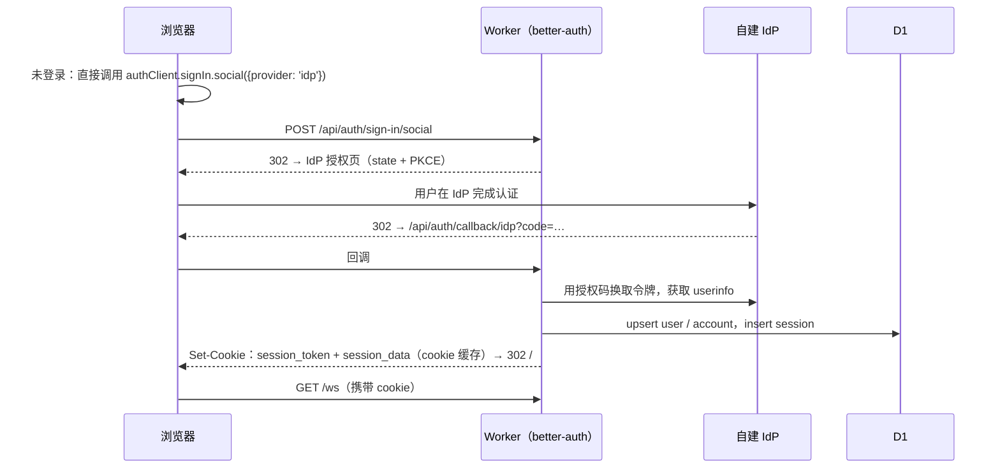

# 06 · 认证与安全

## 身份：better-auth + Generic OAuth（自建可信身份源）

- 用户身份完全来自**自建的可信身份源**（OIDC / OAuth 2.0，下文简称 IdP）。本应用不管理密码，也没有注册表单。
- 服务端使用 [better-auth](https://www.better-auth.com/) **1.7.x**（核实版本 1.7.6）的 `genericOAuth` 插件：它负责授权码流程、PKCE、回调处理和会话管理。数据库直接使用 D1（`database: env.DIRECTORY`）。
- 由于 better-auth 依赖 `node:async_hooks` 的 `AsyncLocalStorage`，Worker 需要开启兼容标志 `nodejs_compat`。
- 开启 `requireIdTokenVerification`：发现文档必须提供 issuer 与 JWKS，ID Token 必须验签。1.7 默认启用 nonce 绑定，防止 ID Token 被重放。
- IdP 被视为可信来源：用户首次登录时自动建号（隐式注册），之后每次登录都用 IdP 的资料覆盖本地资料（`overrideUserInfo: true`）。

### 环境变量

身份相关的是下面 5 个变量（R2 与推送的变量见 [README § 环境变量](../../README.zh.md#环境变量列表)）。非机密的值放在 `wrangler.jsonc` 的 `vars` 中（顶层是模板，chat.jaze.top 的值在 `env.production`），机密值用 `wrangler secret put` 注入；本地开发时机密与要覆盖的值写在 `.dev.vars` 里（不提交）。开发与生产共用同一个 IdP 客户端。

| 变量 | 类型 | 说明 |
| --- | --- | --- |
| `BETTER_AUTH_URL` | var | 本应用对外的基础 URL，用于生成回调地址和 IdP 登出后的跳回地址。`env.production` 中是生产地址 `https://chat.jaze.top`，`.dev.vars` 覆盖为本地开发地址 `http://localhost:5173`（vite dev 的固定端口） |
| `BETTER_AUTH_SECRET` | **secret** | better-auth 签名 / 加密 cookie 的密钥（32 字节以上随机值） |
| `OAUTH_DISCOVERY_URL` | var | IdP 的 OIDC 发现文档地址（`/.well-known/openid-configuration`） |
| `OAUTH_CLIENT_ID` | var | 在 IdP 注册的客户端 ID |
| `OAUTH_CLIENT_SECRET` | **secret** | 客户端密钥 |

通话另有两个可选的机密（见 [04 § 通话](./04-realtime-and-fanout.md#通话)）：`TURN_KEY_ID` 与 `TURN_KEY_API_TOKEN`，即 Cloudflare Realtime TURN key 的 ID 与 API token，用于签发 TURN 凭据。没有配置时只用 STUN，非联系人之间的通话（只走中继）会失败；开发环境下退回直连并打印警告。群组通话要 `SFU_KEY_ID` 与 `SFU_KEY_API_TOKEN`，即 Realtime SFU App 的 App ID 与 App Secret，只在服务端使用（客户端经 `ChatDO` 间接操作自己的 SFU session，拿不到别人的 session ID）；没有配置时群组通话的发布与拉取失败。

其余参数直接写成代码常量，不做成配置项：

| 参数 | 固定值 | 说明 |
| --- | --- | --- |
| `providerId` | `idp` | 回调地址固定为 `{BETTER_AUTH_URL}/api/auth/callback/idp`，在 IdP 登记这个地址 |
| `scopes` | `openid profile email` | 标准 OIDC scope |
| 用户名 claim | `preferred_username` | 标准 OIDC claim |
| 登出跳回地址 | `{BETTER_AUTH_URL}/` | 需要在 IdP 中登记为 post-logout redirect URI |
| 授权 / 令牌 / userinfo 端点 | 从发现文档获取 | 要求 IdP 支持 OIDC 发现（`requireIdTokenVerification` 本身也依赖它） |

配置示意：

```ts
// server/src/auth/index.ts
import { env } from 'cloudflare:workers'
import { betterAuth } from 'better-auth'
import { genericOAuth } from 'better-auth/plugins/generic-oauth'

export const auth = betterAuth({
  baseURL: env.BETTER_AUTH_URL,
  secret: env.BETTER_AUTH_SECRET,
  database: env.DIRECTORY,                       // D1
  user: {
    additionalFields: {
      username: { type: 'string', required: false, unique: true, input: false },  // 来自 IdP，不可改
      bio: { type: 'string', required: false, input: true },                    // 本地可编辑
    },
  },
  session: {
    expiresIn: 60 * 60 * 24 * 60,                // 60 天
    updateAge: 60 * 60 * 24,                     // 每天最多续期一次，控制 D1 写入
    cookieCache: { enabled: true, maxAge: 5 * 60, strategy: 'compact' },
  },
  rateLimit: { enabled: false },                 // 内置限流在 Workers 上无法跨实例共享
  advanced: {
    // 只把会话 cookie 设为 Strict；OAuth state cookie 保持默认 Lax，否则 IdP 回调带不上
    cookies: {
      session_token: { attributes: { sameSite: 'strict' } },
      session_data: { attributes: { sameSite: 'strict' } },
    },
  },
  plugins: [
    genericOAuth({
      config: [{
        providerId: 'idp',
        clientId: env.OAUTH_CLIENT_ID,
        clientSecret: env.OAUTH_CLIENT_SECRET,
        discoveryUrl: env.OAUTH_DISCOVERY_URL,
        scopes: ['openid', 'profile', 'email'],
        pkce: true,
        requireIdTokenVerification: true,
        postLogoutRedirectURI: `${env.BETTER_AUTH_URL}/`,
        overrideUserInfo: true,
        mapProfileToUser: (p) => ({ username: p.preferred_username }),
      }],
    }),
  ],
})
```

- `advanced.database.validateSchema: false`：表结构由 `wrangler d1 migrations` 管理（迁移 SQL 由 `server/scripts/gen-auth-schema.ts` 根据配置生成），关闭运行时自省，省掉每次冷启动的 D1 查询。
- **惰性初始化**：`betterAuth()` 初始化时会抓取 IdP 发现文档。DO 与 Worker 在同一个模块里，所以只在 HTTP 路由里通过 `getAuth()` 首次调用时创建，避免每次 DO 冷启动都发起外部请求。

在 Hono 中挂载：`app.on(['GET', 'POST'], '/api/auth/*', (c) => getAuth().handler(c.req.raw))`。

> MVP 尚未启用 `username` / `bio` 扩展字段（用户通过邮箱查找），上面的示意保留为目标形态。

### 登录流程



- **没有独立的登录页**：前端检测到未登录时，直接发起 `signIn.social`（1.7 起 Generic OAuth 提供方注册为普通社交提供方）。`/login` 路由只用于展示错误，例如 IdP 拒绝授权。
- 退出登录时调用 `authClient.signOut()`。better-auth 1.7 会自动完成 OIDC RP 发起的登出：跳转到 IdP 的 `end_session_endpoint`，登出后再回到应用首页。如果只想退出本应用，可以设置 `disableProviderLogout: true`。

## 会话与设备

- **设备 = better-auth 的一个 session。** `device_id` 就是 `session.id`；设备名称取自 session 中记录的 UA。
- `UserDO.devices` 只保存本应用额外需要的设备状态：设备最后活跃时间、最近一次连接的位置、移除时间（第二阶段加推送订阅）。它不存任何令牌。
- **WebSocket 鉴权**：Worker 在 `/ws` 升级时先用 better-auth 导出的 `getCookieCache` 直接校验 compact 策略的 cookie 缓存（一次 HMAC，不初始化 better-auth、不读 D1）；缓存缺失或过期（5 分钟）时才调用 `auth.api.getSession({ headers })`，读一次 D1。两条路径的吊销语义相同。校验通过后，把 `{user_id, session_id}` 转给 `UserDO`。原因见下文 § Worker CPU 风险。
- **移除设备**：设置页经 WebSocket 调用 `devices.revoke` / `devices.revokeOthers`。`UserDO` 直接删除 D1 中属于本用户的 session 行（`WHERE userId = ?`），记录 `revoked_at`，再以关闭码 `4001` 断开该设备。设备列表 `devices.list` 同样直接查询 D1 的 session 表。
  - **为什么不调用 better-auth 的 `listSessions` / `revokeSession`**：这需要在 Worker 中初始化 better-auth 并校验会话，实测 30–50ms CPU，超出 Free 套餐的 10ms（见下文 § Worker CPU 风险）；而且"删 session"和"断开连接"会分成两步，不是原子操作。代价是依赖 better-auth 的 `session` 表结构（由仓库内的迁移文件固定）。better-auth 的 `revokeSession` 本身也只是删除这一行。
  - 被移除的 session，其 cookie 缓存最多还能通过 Worker 校验 5 分钟。`UserDO` 在接受连接时检查 `revoked_at`，接受后立即以 `4001` 关闭，不按设备上线处理。这条移除记录保留 2 倍 cookie 缓存时长，之后由 `devices.list` 顺带清理。
  - 被移除的设备收到 `4001` 后，先调用 `POST /api/auth/sign-out` 清掉 cookie（session 已不存在，不会跳转到 IdP 登出），再删除本地库，然后显示"本设备已被移除"。**不自动跳转 IdP**：IdP 的登录状态还在时会静默重新登录，所以由用户自己决定是否重新登录。
  - **离线设备**：被移除时不在线、超过 cookie 缓存时长后才重连的设备，Worker 查不到 session 直接返回 401，客户端握手失败后确认未登录，同样删除本地库，但按普通的"未登录"处理，会跳转 IdP；IdP 登录状态还在时会作为一台新设备重新登录。这是有意接受的：身份以 IdP 为准，止损靠 IdP（见 [09 § 开放问题](./09-roadmap.md#开放问题) #7）。
  - 刚登录的设备也可以移除其他设备，没有 24 小时之类的限制。身份来自自建 IdP，真正的止损手段是在 IdP 上改密码、强制下线。
  - 设备列表显示浏览器 + 系统（前端解析 UA，不支持自定义名称）、位置（国家 / 城市 + IP，取最近一次连接）、在线或设备最后活跃时间、登录时间。它在打开设备页时拉取，不进本地库，也不参与 `user_pts` 同步。
- 连接建立后，session 过期不会导致断线：连接的有效性由 `UserDO` 的吊销检查保证。客户端在后台正常续期 cookie 即可。

### D1 写入成本

- 登录：upsert `user`、`account`，insert `session`，每项还要加上索引行，合计约 10 行。
- 续期：`updateAge` 设为 1 天，所以每个 session 每天最多写 1 次。
- 相对于 D1 每天 10 万行的写入额度，可以忽略不计。

### Worker CPU 风险

Free 套餐的 Worker 每次调用只有 10ms CPU。2026-09-29 部署到 workers.dev（Free 套餐）用 `wrangler tail` 实测（`cpuTime`，单位 ms）：

| 路径 | 冷 isolate | 热 isolate |
| --- | --- | --- |
| 启动（`Worker Startup Time`，不计入请求） | 27–32 | — |
| `GET /api/auth/get-session` | 39、66 | 2–9（偶见 17） |
| `POST /api/auth/sign-in/social` | 21 | 7–8 |
| `GET /api/auth/callback/idp` | 56 | —（每次登录一次） |
| `GET /ws`，经 `auth.api.getSession` | — | **31、51** |
| `GET /ws`，先校验 cookie 缓存（现行） | 32 | **5–11** |
| UserDO（升级、消息、关闭） | 0–1 | 0–1 |

- 所有请求都返回 `ok`，没有出现 1102 超限错误，说明平台对偶发超限有宽容度，但不能依赖。
- `/ws` 是每次重连都会走的热路径，因此改为先校验 cookie 缓存（上表最后两行对比）。另一个降级方案（在 `UserDO` 内校验 session）不再需要。
- 登录、OAuth 回调与冷 isolate 的首个请求仍超过 10ms，但频率低，暂时接受。
- **未实测**：cookie 缓存过期后（空闲超过 5 分钟且未调用 `get-session` 就重连）退回 `getSession` 的路径，预计与上表"经 `auth.api.getSession`"一行相当。若成为问题，可以让客户端重连前先调用一次 `get-session` 刷新缓存，或调大 `cookieCache.maxAge`（代价是吊销生效更慢）。

## 传输安全

- **CSWSH（跨站 WebSocket 劫持）**：`/ws` 升级时强制检查 `Origin` 与本站一致；better-auth 的会话 cookie（`session_token`、`session_data`）改为 `SameSite=Strict` 作为双保险。OAuth 流程的 state cookie 必须保持默认的 `Lax`：IdP 回调是跨站的顶层跳转，设成 `Strict` 会导致回调时带不上 state cookie，校验失败。
- **CSRF**：better-auth 自带 Origin 校验（`trustedOrigins`）；本应用自己的写操作端点同样检查 `Origin` / `Sec-Fetch-Site: same-origin`。
- **CSP**：`default-src 'self'`；`script-src 'self'`（不允许 inline）；`img-src 'self' https://r2.chat.jaze.top {IdP 头像域名} blob:`；`media-src 'self' https://r2.chat.jaze.top blob:`；`connect-src 'self' wss://{host} https://*.r2.cloudflarestorage.com https://r2.chat.jaze.top`（后者用于查看器下载图片）；`form-action 'self' {IdP 域名}`；`require-trusted-types-for 'script'`。**直接启用 Trusted Types**，因为不需要考虑兼容性。
- 响应头统一设置 COOP / CORP 和 `Permissions-Policy`；只在需要时向 `camera` / `microphone` 开放权限。

## 内容安全

- 消息正文**不存也不渲染 HTML**：服务端只存 `text + entities`（偏移量 + 类型，与 Telegram 相同）。客户端把 entities 渲染成 React 元素，从根本上避免 XSS。
- 每个入站帧都用 Valibot schema 校验。长度上限：正文 4096 字符，entities 100 个；媒体消息最多 10 项，文件名 255 字符。
- **媒体接口**（`POST /api/media/upload`、`DELETE /api/media`）与 `/ws` 一样校验 Origin，并用 cookie 缓存确认身份。媒体对象键里带着上传者 ID，发送与删除时都要求键是自己的待发键，见 [05 § 上传](./05-media.md#上传)。
- **链接预览**（`POST /api/link-preview`、`/api/link-preview/image`）同样校验 Origin 与登录会话。抓取只允许 `https:` 与默认端口，拒绝 IP 字面量、保留域名、单段主机名与应用自己的域名，重定向逐跳检查，限时、限字节。取回的图片只接受常见位图格式，带 `nosniff` 与 `sandbox`，只交给发送方压缩，不在本站显示。卡片由发送方生成、可以被伪造，所以域名与去向总是取自正文里的链接，见 [05 § 链接预览](./05-media.md#链接预览)。

## 限流

| 位置 | 机制 | 成本 |
| --- | --- | --- |
| 按用户 | `UserDO` 内存令牌桶（发送消息 20 条/10 秒，建群 10 个/小时……） | 零成本，天然按用户隔离 |
| 按会话 | `ChatDO` 内存令牌桶（慢速模式） | 零成本 |
| 登录 | 由 IdP 负责；better-auth 内置的限流器在 Workers 上无法跨实例共享，因此关闭 | — |

内存令牌桶在对象休眠后会重置，这对防滥用可以接受。

## 权限模型

- 权限判定只在 `ChatDO` 中进行，依据是 `members.role` 和 `rights`。
- 群组人数上限为 **20 人**（`MAX_GROUP_MEMBERS`），邀请和加入时都在 `ChatDO` 中校验。
- 角色：`owner` / `admin` / `member`。
- 管理员权限位参照 Telegram：`change_info`、`delete_messages`、`ban_users`、`invite_users`、`pin_messages`、`manage_admins`。
- **邀请链接**：`/join/{群组 ID 去掉 g: 前缀}.{令牌}`，令牌是 `ChatDO` 在 `info.invite` 里保存的 128 位随机数，按常量时间比较。群主重置即换一个令牌，所有旧链接随之失效。邀请码自带 chat_id，不需要全局表；令牌本身就是随机数，不必再做 HMAC。
- 被群主移除的人不能凭链接回来：`members.left_seq` 指向他离开的那条服务消息，是 `member_remove` 就拒绝，不需要额外的字段。

## 端到端加密

"秘密聊天"是一种独立的会话类型，只做一对一，双方的每台设备都在里面。决策与权衡见 [ADR-0010](../adr/0010-secret-chats-multi-device-mls.md)。

- **协议**：MLS（RFC 9420），库为 `ts-mls`（套件 1：X25519 + AES128GCM + Ed25519，**未经正式审计**），只在用到秘密聊天时加载。所有 MLS 运算都在同步 Worker 里做。每台设备是组里的一个叶子，凭证写明 `[user_id, device_id]`，只接受这两个人的凭证。
- **加入**：每台设备在自己的 `UserDO` 里放 4 个一次性 KeyPackage 与 1 个可重复使用的最后备用，用到不足一半时补齐。开始秘密聊天的设备把双方当时的所有设备一起加入；之后新设备上线、设备被移除、设备丢了本地状态，都由第一台在线的成员设备对照服务端的设备列表提交 Add / Remove，被加入的设备凭 Welcome 加入。领到的 KeyPackage 必须真是那台设备的（凭证与服务端说的一致）。
- **消息**：每个纪元用 MLS exporter 导出一把 AES-256-GCM 密钥（标签 `web-chat secret message key`，上下文为 chat_id）。密文格式：版本 | 纪元 | 发送设备的叶子序号 | nonce | 密文 | Ed25519 签名（发送设备的叶子签名密钥）。附加数据与签名都覆盖绑定信息：会话、发送者与用途（新消息、编辑第几条、回应第几条），服务端不能把密文挪到别的会话、别的发送者名下或别的消息上；明文里带 `random_id`，服务端把同一条密文复制成两条时客户端认得出来。
- **服务端看不到的**：消息、编辑与回应的内容（回应的 emoji 也加密），媒体的内容、类型与文件名，对话摘要（客户端解开后显示）；推送正文固定为"New message"；草稿不同步；不抓链接预览；不能转发、置顶消息，不能通话。服务端知道的：谁和谁有秘密聊天、消息的时间与长度、媒体对象的个数与大小、双方的设备列表（设备变化写成服务消息）。
- **安全码**：组里所有设备的身份与签名公钥排序后取 SHA-512，换成 12 组 5 位数。双方核对一致，说明双方的设备都是对方以为的那些；服务端给的设备列表就靠它兜底（不做交叉签名）。设备变化时安全码随之变化，会话里出现一条服务消息。
- **本地保存**：KeyPackage 私钥、MLS 状态与各纪元的密钥，用存在 IndexedDB 里、不可导出的 AES-GCM 密钥加密后才写进本地库。**这一层只保护密钥材料**：消息解开后，正文像普通消息一样以明文存在本地库里（但不进本地全文搜索索引，秘密聊天也没有会话内搜索），媒体的密钥也在里面；拿到本地库文件的人读得到已经解开的聊天记录，在撤回之前还能取回并解开其中的媒体。服务端看不到内容这一点不受影响。
- **本地数据丢失**：退出登录、清除站点数据，或浏览器清掉 OPFS 都会丢掉密钥（客户端表结构升级是增量迁移，不会丢）。设备随后作为新设备被重新拉进来，丢失之前的历史无法再解开（显示为不可见）；双方所有设备同时丢失时只能删掉重开。
- **删除**对双方生效：服务端删掉消息、提交与加密的媒体，双方所有设备删掉对话与本地密钥。
- **媒体**：客户端用每个媒体一把的 AES-256-GCM 密钥加密后再上传，密钥与发送后的键放在加密的消息里，R2 里只有密文；申请上传时只给加密后的大小，服务端看不出类型与文件名。见 [05 § 秘密聊天的媒体](./05-media.md#秘密聊天的媒体)。
