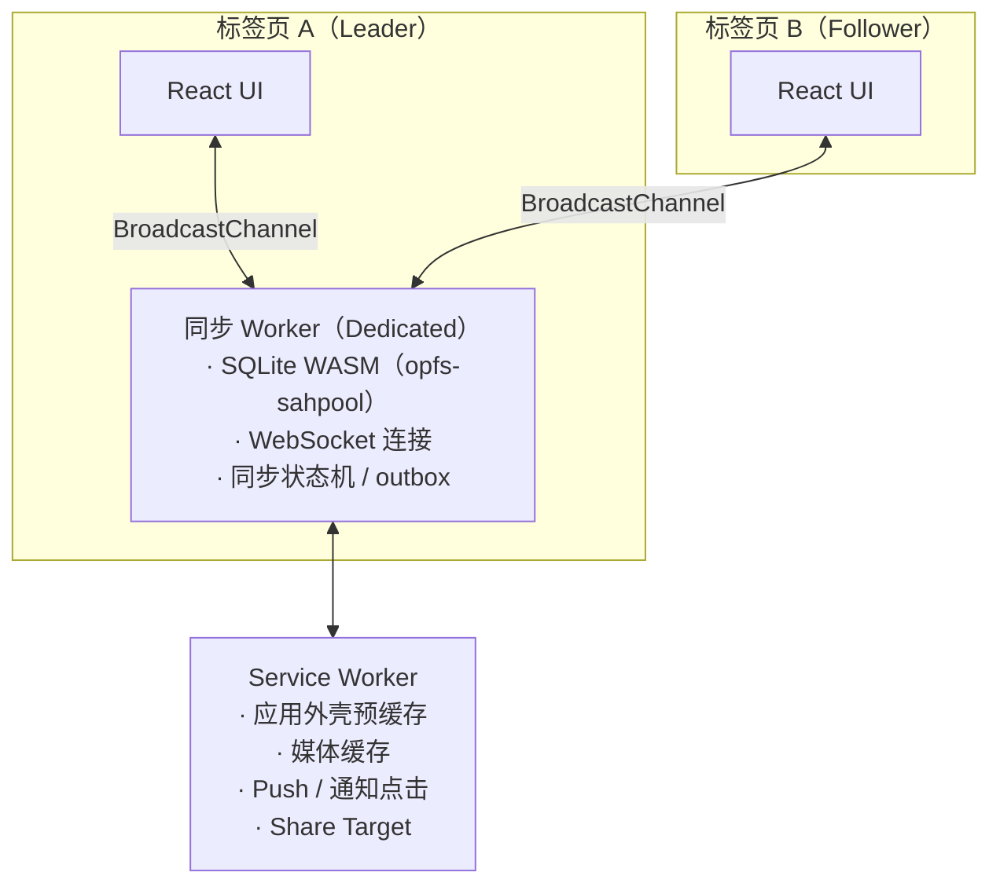

# 07 · 客户端架构

目标：打开即显示（本地数据秒开），离线可读可写，多标签页共享同一个连接。

## 线程模型



- **Leader 选举**：每个标签页都排队请求 `navigator.locks.request('web-chat-leader', …)`，拿到锁的标签页启动同步 Worker 并一直持有锁。Leader 关闭后锁被释放，下一个标签页自动接任。
- **同步 Worker 直接监听 `BroadcastChannel`**，为所有标签页（包括 Leader 自己）服务，不经过 Leader 主线程中转。请求带标签页 ID 与请求 ID；新 Leader 就绪时广播 `ready`，各标签页重放尚未得到结果的请求。因此所有请求都必须幂等：例如发送消息的 `random_id` 由标签页生成，重放不会重复入队。
- **交接时本地库可能仍被占用**：上一任 Worker 释放 OPFS 句柄之前，新 Worker 安装 `opfs-sahpool` 会失败，需要带退避重试。
- **本地库在运行中丢失时自动重建**：浏览器可能在 Worker 运行期间清掉 OPFS（实测在无痕式上下文里闲置后发生），之后每次读写都报 `no such table`，连接却仍然在线，收到的更新全部丢掉。同步 Worker 在请求出错和未捕获的异常时检查表结构版本，对不上就断开连接、关闭本地库，请 Leader 标签页终止它（释放 OPFS 句柄）并换一个新的 Worker。新 Worker 像首次登录一样建库、全量同步，就绪后广播 `ready`，与换 Leader 走同一条路。没发出去的发件箱随本地库一起丢失。
- **服务端以关闭码 4000 顶替同一设备的旧连接**，收到后不再重连，避免两个 Worker 互相踢下线。
- 之所以不用 SharedWorker：OPFS 的同步访问句柄（`createSyncAccessHandle`）只能在 Dedicated Worker 中使用，而 SQLite 的高性能 VFS 依赖它。
- **一个源只有一条 WebSocket**，不随标签页数量增加，这同时节省了服务端的 DO 请求。

## 本地数据层

- 使用官方 SQLite WASM + `opfs-sahpool` VFS。表结构见 [02 § 客户端 SQLite](./02-data-model.md#客户端-sqliteopfs)。
- **UI 只读本地库**：所有读取都是对本地 SQLite 的查询；网络只负责把数据写进本地库。
- **响应式查询**：同步 Worker 每次提交事务后，广播受影响的"主题"（`dialogs`、`users`（资料与关系）、`outbox`、`chat:{id}`；任一 `chat:{id}` 变化时另加 `messages`，供全局搜索使用）。UI 端的 `useLiveQuery(sql, params, topics)` 基于 `useSyncExternalStore`，只在相关主题变化时重新查询。这是一层约 100 行的自有封装，不引入状态管理库。
- **登录状态本地优先**：`localStorage` 缓存当前用户，启动时立即打开对应的本地库并渲染，同时在后台请求 `get-session`。明确未登录或换了账号时删除本地库并重新启动；网络错误时继续离线使用。浏览器不暴露 WebSocket 升级请求的 401（只看到 1006），因此同步 Worker 在握手连续失败后才检查 `get-session`。
- **退出登录会删除本地库**，顺序固定：先删除发件箱里已上传、还没发出去的媒体（之后会话失效就删不了了），同时退掉本机的推送订阅并告知服务端（免得这个浏览器之后还收到本账号的通知；没退掉的，服务端发现 session 已失效时也不再推送），再在服务端结束会话并取得 IdP 登出地址，然后让同步 Worker 断开连接、清空 OPFS，最后跳转（跳转会终止 Worker）。无论是退出登录、换了账号还是本设备被移除，清空本地库时都一并清掉本机的角标、通知、浏览器里的推送订阅（换账号后不会把旧 endpoint 报给新账号；旧 endpoint 此后返回 410，由服务端清除）、媒体缓存与没发出的分享内容。发件箱非空时先二次确认。
- **乐观更新**：发送先写本地库（outbox + 乐观消息），服务端确认后用真实的 `seq` / `pts` 替换乐观数据，失败则标记为"发送失败"，可以重试或删除。编辑、撤回与回应必须在线，直接请求服务端，结果经 `upd` 推回本设备。
- **发件箱逐条发送**：同一会话严格按入队顺序发送，一次发送的多条消息（相册 → 文件 → 文字）在同一事务入队。媒体消息先上传再发送，待上传的文件暂存在 OPFS 的 `outbox/` 目录，刷新或换 Leader 后接着传；上传进度作为瞬时消息广播给标签页。见 [05 § 上传](./05-media.md#上传)。
- **本地搜索**：用 FTS5 `trigram` 搜索本地已有的消息，零服务端成本，**服务端不做全文搜索**。可搜索的是文本正文与文件消息的文件名，秘密聊天的消息不进索引；只搜各会话 `min_seq` 之后连续的部分（更早的行只是回复引用），所以任何结果都能直接在本地定位。输入按空白拆成关键词，全部命中才算匹配；≥3 个码点的走 FTS（每个词作为短语，转义双引号），更短的退化为 `LIKE`（转义通配符）。SQL 在 `features/search/sql.ts`，单测直接跑 sqlite-wasm 内存库。
- **备注名**：本地库的 `people` 视图把备注名套在资料上（`name` 为备注名或对方自己的名字，`own_name` 总是对方自己的名字）。界面上凡是显示别人名字的查询都读这个视图，所以对话列表、群里的发送者、服务消息、搜索都用备注名。
  - **全局搜索**：对话列表顶部的搜索框，输入后列表原地换成结果：依次是会话名（群名，或私聊对方的备注名与名字）匹配的对话、还没有对话的联系人，然后是本设备上的消息，新的在前、滚到底加载更多。Esc 或清空恢复对话列表。点击消息结果打开 `/c/{chatId}?m={seq}`。
  - **会话内搜索**：标题栏按钮或 Cmd/Ctrl+F 打开 Command（cmdk，`shouldFilter={false}`，结果由 SQL 给出）；桌面端是 `CommandDialog`，移动端是 Drawer。选中一条就关闭并定位。本地历史不完整（`min_seq > 1`）时末尾有「Search older messages」：逐页（每页 `MAX_PAGE_LIMIT` 条）拉取更早的历史直到开头，显示进度，关闭搜索即停止。关键词与选中项保留到离开会话。

## Service Worker 与安装

- **构建**：入口是 `src/sw/index.ts`，构建产物固定为 `/sw.js`（地址不能带哈希），以模块方式注册。`vite.config.ts` 的 `swBuild` 插件在产物开头定义本次构建的外壳文件清单（`assets/` 下的全部文件）和版本号（取清单与 `index.html` 的哈希）。开发时 `/sw.js` 映射到源文件，不预缓存资源。
- **外壳缓存**：安装时把 `/`（即 `index.html`）和全部 `assets/` 预缓存到 `shell-{版本}`，激活时删除旧版本。导航走网络优先（开启导航预加载），3 秒内没有响应或离线时回退到缓存的外壳；`assets/` 缓存优先。`/api/*`（含 OAuth 回调）与 `/ws` 不经过缓存；其中的导航仍要由 SW 用预加载的响应应答，否则浏览器丢弃预加载再请求一次，OAuth 回调的 state 被消费两次而报 `state_mismatch`。不用 `/index.html` 作缓存键，因为静态资源会把它 307 重定向到 `/`，重定向过的响应不能用于导航。
- **更新**：新 SW 安装后立即接管（`skipWaiting` + `clients.claim`），不提示。导航网络优先，所以每次打开几乎都是最新版；协议不兼容旧客户端（见下文 § 新版本），不适合缓存优先。
- **媒体缓存**：媒体域名上的图片缓存优先，见 [05 § 客户端缓存](./05-media.md#客户端缓存)。
- **推送通知**：SW 收到推送后按载荷显示通知，`tag` 为 `chat_id`，新消息 `renotify`，撤回与编辑 `silent` 替换。点击通知时，有打开的窗口就聚焦并 `postMessage` 让页面内路由打开会话，没有就 `openWindow('/c/{chatId}')`。打开会话且页面可见时，关掉本机这个会话的通知。
- **推送订阅**（`features/notifications/push.ts`）：Chrome 的 Dedicated Worker 里没有 `navigator.serviceWorker`，所以订阅由标签页取得，经 `setPush` 交给同步 Worker；同步 Worker 记住它，每次连接后用 `push.set` 上报（换 Leader 时标签页重新交一次）。本机开关存在 `localStorage`：权限已授予且没有关闭时，启动时自动订阅（不需要用户手势）；开启时先退掉旧订阅再订阅，endpoint 随之更换。每台设备第一次登录后弹一次带「Turn on」按钮的 Toast；设置 → Notifications 里有本机开关与通知预览。iOS 只有添加到主屏幕后才有推送，此时开关处提示先添加。
- **分享目标**（Web Share Target，仅 Chromium）：Manifest 的 `share_target` 把系统分享面板的文字、链接与文件 `POST` 到 `/share`。SW 拦下后把内容暂存到 IndexedDB `share`（只留最新一次），再 303 跳转到 `/share` 页面。页面复用对话列表选会话（桌面端在左栏，移动端在主区，顶部一条 Alert 可取消）；选中后输入框预填分享的文字与附件，由用户确认后发送。退出登录时连同暂存一起清除。
- **图标**：`favicon.svg` 是 lucide `message-circle`，有未读时换成 `favicon-unread.svg`（`message-circle-more`），都随系统深浅色切换描边颜色。应用图标是同一图形，深色底、白色描边，另有一份 maskable 版本。PNG 由 `bash scripts/gen-icons.sh` 调用本机 Chrome 无头模式从 `public/icons/*.svg` 生成。

## 新版本

协议不兼容旧客户端，本地库只做增量迁移（见 [ADR-0013](../adr/0013-forward-only-migrations-after-1-0.md)），所以发布新版本后，旧页面要尽快重载（`lib/reload.ts`）：

- **触发**：服务端以 `4002` 拒绝了旧的协议版本，此时同步 Worker 广播 `outdated`，`newest` 为 `Infinity`。标签页与同步 Worker 不是同一次构建：构建版本 `BUILD` 是构建时间，随每个请求一起带上，同步 Worker 不处理其他构建的请求，并广播 `outdated`，构建早于 `newest` 的标签页重载；`ready` 也带着同步 Worker 的构建，比它旧的标签页重载。本地库的版本号比代码新：同步 Worker 不碰本地库，请 Leader 标签页重载。懒加载的代码块加载失败（`vite:preloadError`）：旧文件在发布后已经不在了。
- **只有新版本迁移本地库**：旧的同步 Worker 继续为同一构建的标签页服务，直到这些标签页重载、释放 Leader 锁；之后接任的是新版本的 Worker，由它迁移本地库。旧标签页抢到 Leader 锁时，会发现本地库比自己新，于是重载。
- **推迟**：通话（包括来电在响）、录音（包括被打断后还没发出的录音）、上传进行中时不重载，每秒检查一次，结束后再重载。代价是：旧标签页在通话中占着 Leader 锁时，同一浏览器里新开的标签页会一直显示连接中。
- **重载**：先让 Service Worker 检查更新（最多等 5 秒），再 `location.reload()`。重载前把当前构建记在 `sessionStorage`：重载后还是同一个构建（没拿到新版本），就不再重载，免得无限刷新。

## 路由与页面

| 路由 | 视图 |
| --- | --- |
| `/` | 对话列表（左栏）+ 空状态 |
| `/c/:chatId` | 会话（移动端全屏；桌面端两栏，还可以打开第三栏的资料面板） |
| `/c/:chatId/info` | 会话资料、成员、共享媒体 |
| `/u/:userId` | 资料页：名字、备注名、在线状态；发消息（仅联系人）、加为联系人 / 改备注名 / 删除联系人、拉黑 / 解除拉黑。打开时像打开私聊一样登记查看，据此拿到在线状态 |
| `/pip/:chatId` | 画中画小窗里 iframe 加载的页面，见下文 |
| `/settings/*` | 资料、隐私、设备、通知、存储 |
| `/join/:code` | 邀请落地页 |
| `/login` | 仅展示登录错误；未登录时自动跳转到 IdP（better-auth `signIn.social`） |

路由使用 TanStack Router（代码定义路由树，不引入文件路由插件），它提供类型安全的参数和 search params。路由树在 `app/router.ts`，各路由的组件在 `app/routes.tsx`（从地址里取出参数交给页面）；不在首屏的页面（登录、会话资料、资料页、邀请、分享、画中画）用 `lazy` 按需加载，首屏只有对话列表与会话页。同样按需加载的还有不在首屏的弹窗与面板：设置、新建群组、转发、会话内搜索、我的贴纸、联系人与最近通话面板、群组通话界面。弹窗第一次打开时才挂载（`useOpened`），之后保留，关闭动画照常。

- **布局**：对话列表放在 shadcn `Sidebar` 中。结构按官方组织：`SidebarHeader` 放搜索框与「更多」菜单（身份、联系人、设置、退出登录），`SidebarContent` 放对话列表（`SidebarGroup` > `SidebarMenu`），右下角悬浮新建按钮（新建私聊 / 群组，列表向下滚动时收起）。桌面端宽 18rem，可完全收起（`collapsible="offcanvas"`，Cmd/Ctrl+B，各页左上角有 `SidebarTrigger`）；移动端 Sidebar 变为全宽抽屉（头部左侧有收起按钮），首页 `/` 在主区直接渲染同一个对话列表；会话页左上角是返回箭头（后退一步，不新增历史，直接打开的会话换成首页），资料页、群资料页只有返回按钮，没有 `SidebarTrigger`。没连上服务器时（连接中或等待网络），页面顶部显示一条不定进度条。所有原生滚动条为透明轨道（全局 `scrollbar-thumb-border scrollbar-track-transparent`）。
- **联系人**：「更多」菜单的 Contacts 与新建按钮的 New chat 都把侧栏换成联系人列表（带返回按钮与筛选框，右侧页面不动）。列表头部可以按邮箱添加联系人（可同时设备注名），加好后直接打开私聊。点一个人打开私聊并回到对话列表；悬停时的按钮打开资料页。新建私聊与拉人进群只能从联系人中选，这只是界面入口，服务端不校验。黑名单在 设置 → Privacy。
- **对话列表**：置顶对话在最上面（后置顶的在前），其余按最后一条消息的时间；全局搜索的结果不受置顶影响。对话项右键（触屏长按）菜单：置顶 / 取消置顶、静音（1 小时、8 小时、1 天、7 天、永久）/ 取消静音，只读对话还有删除对话。会话标题栏的「更多」菜单也能静音。静音的对话名字旁有图标，未读数显示为灰色，不计入角标、favicon 与画中画里的其他未读总数；静音是否生效由查询时的当前时间决定（`unixepoch('subsec')`），同步 Worker 在最近一次到期时通知 `dialogs` 主题让查询重新执行（永久静音不设定时器）。
- **草稿**：输入框打开会话时从本地库 `drafts` 恢复一次（连同回复目标，被回复的消息本地没有时只恢复文字），之后其他设备同步来的草稿不覆盖输入框。离开会话（输入框卸载）与页面转入后台时交给同步 Worker：先写本地库并标记未确认，有变化才 `dialogs.update`；服务端确认的值与本地一致才去掉标记，离线时重连后再同步。草稿恢复完成前不保存，免得很快离开时用空草稿覆盖。发出消息时本地草稿随之删除，服务端在发送时也清空，不另行同步。编辑消息时保存的是编辑前暂存的文字。对话列表在没打开的对话上显示 `Draft: …`。
- **拉黑**：我拉黑了对方时，私聊的输入框换成解除拉黑的底栏；对方被拒绝的发送留在发件箱，标记为发送失败并注明原因（发件箱的 `error` 列）。拉人进群被拒时，表单里指出是谁。
- **界面**：文案为英文硬编码（不引入 i18n）；只提供深色主题。路由切换用 View Transitions API 做共享元素动画（头像 → 资料页）。

## 消息列表

- **不引入虚拟列表库**。消息区使用自行实现的滚动容器（`features/chat/message-scroller.tsx`，视口是原生 overflow 元素：shadcn ScrollArea 不暴露视口的 ref 与滚动事件），每条消息一个 `MessageScrollerItem`，带 `content-visibility: auto`，由浏览器跳过屏幕外元素的渲染；内存里只保留一个消息窗口，滚动到边界时从本地库每次多取 50 条（不裁剪另一端）。
- **消息窗口**有两种：**最新窗口**是最新的 N 条，后面接着发件箱；**锚定窗口**是某条消息之前 N 条加上从它起的 M 条，向上、向下滚动时分别扩大，扩大到包含最新一条后转回最新窗口。
- **定位消息**：地址带 `?m={seq}` 时（搜索结果、会话内搜索），窗口换成以它为锚点、前后各 50 条；查询结果里出现目标、列表能显示出来后重建滚动容器（`key` 变化），目标作为滚动锚点（滚动容器只在挂载时使用锚点），定位完成前两个方向都不扩展窗口（那时显示的还是旧窗口），短暂高亮（`MessageScrollerItem` 的 `highlighted` variant）。目标本地已经没有时回到底部并提示。收到后从地址中去掉 `m`（`replace`，不做 View Transition），同一条可以再次定位。
- **锚定窗口不跟随底部**（关闭 `follow`），否则滚到窗口底部会一路向下扩展到最新；右下角按钮换成最新窗口并滚到底。锚定时自己发了消息（发件箱接在最新一条之后）也回到最新窗口。「自己发的消息平滑滚到底」只在最新窗口里、最后一条变化时生效，挂载时的位置交给滚动锚点。
- **回复引用跳转**：点击气泡里的回复引用就定位到被回复的消息（本地还没有的引用是骨架占位，不能点）。被回复的消息早于本地连续的部分（`min_seq`）时，先逐页（每页 `MAX_PAGE_LIMIT`）向上补齐再定位。跳转前所在的消息压进一个栈：右下角按钮先逐级退回这些位置，退完了才回到最新；栈只在内存里，离开会话或最新一条进入视口时清空。
- 打开会话时未读超过一屏窗口：以首条未读为锚点打开（之前留 10 条），而不是把最新窗口放大到能容纳全部未读。换窗口的过程与定位消息相同（结果到达后重建滚动容器），只是不高亮。
- 最新窗口默认贴底、贴底时跟随新消息（`follow`）：追加的消息带入场动画（淡入上移，`prefers-reduced-motion` 时只淡入），视口平滑滚到底（`prefers-reduced-motion` 时直接到底）；尺寸变化（图片加载）时直接贴底。不贴底时，内容或尺寸变化（向上插入历史、上方图片加载、`content-visibility` 估算尺寸被替换）后把视口里顶边可见的第一条放回原处（只露出下半截的那条自己还可能变高，不能以它为准；按它在内容里挪动的距离调整视口，不按相对视口的位置：iOS Safari 异步滚动，上次滚动事件后视口可能又滚了一段，按视口位置补偿会把这段也退回去）。触摸滚动中（按下手指到抬起后惯性停下 150ms）不写 `scrollTop`：iOS Safari 随后会从自己原来的位置接着滚，视口往回跳；补偿先攒着用内容的 `translate` 抵消，停下后与去掉 `translate` 在同一帧里写进 `scrollTop`；浏览器自带的滚动锚定关闭（`overflow-anchor: none`），只保留这一套机制。平滑滚动不用浏览器的 `scrollTo({ behavior: 'smooth' })`，而是逐帧驱动的临界阻尼弹簧，每帧重新读取底部位置：发送一条消息会连着触发多次渲染与尺寸变化（发件箱插入、估算尺寸被替换、输入框变矮、发件箱换成已落库的消息），原生平滑滚动每次重发都从零速重新开始，看起来一顿一顿的；滑动途中的这些变化只改变目标，速度连续。滚轮、触摸、滚动按键、拖动滚动条视为用户接管，打断滑动。离开底部只认往上滚：输入框上方的横栏展开时视口逐帧变矮，自己滚到底的滚动事件晚一帧才到，那时离底部又远了几像素，不能当成用户离开。`MessageScrollerContent` 的直接子元素只能是消息项：保持视口、判断追加都按子元素算。消息项的 React key 对自己发的消息用 `random_id`：发送成功从发件箱换成已落库的消息时沿用同一个元素（只是 `messageId` 从 `o{random_id}` 变成 `m{seq}`），入场动画不被打断、不重播。
- 消息使用 Message + Bubble；时间分组标题、「未读消息」、服务消息使用 Marker 的 `center` variant（居中，不带分隔线），分组标题与未读放在对应消息的项内，不吸顶。
- **键盘**：有鼠标的设备上（`pointer: fine`）打开会话时焦点在输入框，触屏上不自动聚焦（免得弹出键盘）。消息列表是一个 Tab 停留点：方向键在消息之间移动（从列表进入时先到最新一条），Home / End 到窗口里的第一条与最后一条，Enter 或 Shift+F10 在气泡旁打开右键菜单；气泡里的链接、语音进度条等照常用自己的按键。每条消息先给读屏读出发送者（"You:" / 名字），回复引用读作 "Reply to …"。
- **回应**：消息的右键（触屏长按）菜单顶部是一排 8 个 emoji（`ContextMenuGroup` 的 `row` 布局 + `ContextMenuItem` 的 `icon` 尺寸），不做悬停快捷栏与双击。气泡下沿用 `BubbleReactions` 显示"emoji + 人数"标签，自己选过的高亮，点击切换自己的回应；群组里悬停标签用 Tooltip 列出回应的人。只读对话只显示，不能点。
- **提及**：群组的输入框里，光标前输入 `@` 时在输入框上方列出匹配的其他当前成员（按备注名或对方自己的名字筛选，最多 6 个）；焦点留在输入框，上下键选择、Enter / Tab 选中、Esc 关闭。选中后插入 `@对方自己的名字`（不插备注名，备注名只有自己看得到），发送时把文字里仍然完整的 `@名字` 变成提及实体；草稿只存文字，不存提及。气泡里的提及是指向资料页的链接（画中画里不跳转）。对话列表在未读数旁显示 `@`；会话里右下角浮着 `@` 按钮，依次定位到未读的提及。未读提及由服务端记在对话行里，客户端查询时再与本地的已读位置比较，所以读到之后立即消失。
- **转发**：消息菜单里的 Forward（只读对话里也有）打开转发选择器（Dialog，移动端 Drawer）：可以搜索的会话列表，包括自己还是成员的对话（不含自己拉黑了的私聊）与还没有对话的联系人，最多选 10 个；下面可以附带一段文字。逐个会话依次转发，附带的文字在每个会话里另发一条；部分失败时在表单里指出是哪些，已经转发成功的再提交时不会重复（每个目标的 `random_id` 在这次打开期间不变）。只转发到一个会话时直接打开它。转发来的消息在气泡顶部注明"Forwarded from 名字"（备注名优先，点名字打开资料页），不能编辑。
- **置顶消息**：标题栏下方浮着一条置顶条（Item 的 `quote` variant，同样毛玻璃），显示一条置顶消息，后置顶的先显示；点击用回复引用跳转的同一套机制定位过去，并换成更早的一条，到头后从最新的重新开始。右侧按钮打开全部置顶的列表（Dialog，移动端 Drawer），点一条定位过去，群主或私聊双方可以在这里取消置顶。消息菜单里有 Pin / Unpin。有置顶条时消息列表的上边距、定位跳转的目标位置与可见性判定都再让出它的高度。置顶条放在滚动区之外：跳转会重建滚动区，置顶条要保住当前显示的是哪一条。
- **按时间分组**（参考 iMessage）：每条消息不显示时间；与上一条跨天或相隔 15 分钟以上时另起一组，组首显示日期与时刻。「已编辑」与发送状态（Sending… / Sent / Read）放在气泡下方的 `MessageFooter`，发送状态只显示在自己发的最后一条下面；群组暂不展示已读回执，只到 Sent。
- 性能不达标时，再评估 `@tanstack/react-virtual`（不在已确认清单中，引入前需确认）。

## UI 组件与规则

严格遵守 UI 规则：shadcn 组件组合实现、主题变量、gap 布局、variant 优先。对应关系：

| 场景 | 组件 |
| --- | --- |
| 首屏加载对话列表 / 消息 | Skeleton |
| 上传 / 下载进度 | Progress |
| 发送中、其他等待 | Spinner（按钮加载状态：文字左侧 + Spinner） |
| 空对话列表、会话不存在 | Empty |
| 操作提示（已复制、发送失败） | Toast（shadcn `toast` 组件，不使用 sonner） |
| 离线横幅、权限不足 | Alert |
| 撤回消息 / 退出群组 | AlertDialog |
| 新建群组、转发选择器 | Dialog（移动端 Drawer） |
| 资料编辑（简介）、建群表单 | Field + TanStack Form + Valibot，提交时校验 |
| 成员列表（管理视图） | Data Table（`components/data-table.tsx`）+ TanStack Table |
| 设备列表、黑名单 | Item |
| 消息区滚动 | 自行实现的 MessageScroller（`features/chat/message-scroller.tsx`） |
| 对话列表滚动 | ScrollArea |
| 图片 / 视频占位 | AspectRatio + ThumbHash |
| 头像悬停资料卡 | HoverCard；图标按钮说明使用 Tooltip |
| 会话内搜索 | Command（`CommandDialog`，移动端 Drawer） |
| 输入框 + 附件 / 发送按钮 | InputGroup |
| 待发送附件、文件消息 | Attachment（附件栏用 AttachmentGroup 横向滚动，竖向滚轮转为横向；图片只显示图片本身（不用 Attachment），视频显示封面与时长、转码中显示 Progress，点开复用相册的全屏查看器，悬停时右上角出现删除） |
| 消息长文本排版 | Typeset |

## 画中画

会话标题栏的按钮把当前会话弹成置顶小窗（Document Picture-in-Picture，只有 Chromium 桌面版支持，其他浏览器不显示按钮）。同一时间只有一个，对另一个会话再开时小窗换成新会话。

- **小窗里放一个同源 iframe**，加载 `/pip/{chatId}`，而不是把 React 子树直接渲染进小窗。Base UI 的弹层默认挂到当前 `document.body`，可见性、选区、窗口宽度也都按当前 `document` 算；直接渲染的话菜单、确认框和 Toast 都会出现在主窗口里。iframe 有自己的 `document`，这些自然都在小窗里，也不需要复制样式表。
- iframe 就是又一个 Follower 标签页：经 Leader 读写本地库，登记正在查看的会话，可见时上报可见。所以小窗可见时，即使主窗口在后台，设备也算作在前台（在线、已读前移、不发推送）。它不启动推送订阅；点通知时 Service Worker 不选小窗本身（`about:blank`）与其中的 iframe。
- 小窗里的会话页没有侧栏、会话内搜索与标题栏跳转；右上角显示其他会话的未读总数，点击调用主窗口挂在小窗 `window` 上的 `returnToApp` 尝试聚焦主窗口（浏览器不允许时，用小窗自带的返回按钮）。

## 通话

一对一通话与群组通话（见 [04 § 通话](./04-realtime-and-fanout.md#通话)）的客户端在 `features/calls/`：`session.ts` 是一对一的，`group-session.ts` 是群组的，界面共用视频、声音与通话条的组件。

- **通话在标签页里**：`RTCPeerConnection` 不能在 Dedicated Worker 里用，所以通话放在发起或接听的那个标签页里。同步 Worker 记下这个标签页，只把信令转给它；通话状态广播给所有标签页，来电在每个标签页都显示。换了 Leader（同步 Worker 重建）时，通话所在的标签页在 `ready` 后认领回来；连接重连时同步 Worker 用 `calls.current` 向服务端认领。关掉标签页时尽量挂断。
- **三个收发器一开始就建好**：麦克风、摄像头、屏幕，顺序固定。开关摄像头与屏幕共享只用 `replaceTrack` 换轨道，不重新协商；屏幕共享与摄像头可以同时发。只有主叫方发 offer（包括网络变化后的 ICE 重启），被叫方要重启时请主叫方来，避免双方同时发 offer。
- **双方的开关状态**（麦克风、摄像头、屏幕）经一个协商好的 DataChannel 告知对方，不经过服务端；对方据此决定显示摄像头还是头像、屏幕是不是主画面。
- **中继**：对方不在我的联系人中时 `iceTransportPolicy: 'relay'`。
- **界面**：通话界面覆盖整个窗口，对方共享屏幕时屏幕是主画面、摄像头缩到角落。可以收起成头部的通话条（在通话中代替播放条），对方的声音照常播放。视频可以用 `requestPictureInPicture()` 弹出画中画，浏览器同一时间只有一个画中画，所以它会替换掉会话画中画。
- **最近通话**：侧栏「更多」菜单进入，本地 `calls` 表连同 `people` 视图显示对方的名字；点一对一通话回拨，点群组通话打开会话并定位到那条通话记录。
- **群组通话**也在加入的那个标签页里，持有到 SFU 的连接。发布、拉取都是请求与返回（同步 Worker 只是转发），不需要把信令路由到标签页；同步 Worker 记得各群组的通话快照，广播给所有标签页显示横条。对 SFU 的变更排成一队，一次只做一个，SDP 交换做完再做下一个。在通话里时标签页持有 `GROUP_CALL_LOCK`（Web Lock），同步 Worker 排队等它，拿到即说明标签页没了，替它离开；同一台设备上另一个标签页因此也加入不了。加入时总用新生成的 `call_id`（记得的通话可能已经结束），开不开麦以服务端返回的状态为准。客户端按房间状态拉取所有别人发布的媒体、忘掉不再发的，并按放大的画面换摄像头的层。说话的人由本地的接收统计（`audioLevel`）判断，不经过服务端。
- **群组通话的界面**：标题栏下方的横条显示参与者与人数，从这里加入，消息列表与置顶条随之下移；标题栏的通话按钮在没有通话时发起、有时加入。通话界面是宫格（1、2、3、4 列随人数变化），点一路放大成主画面、其余缩成一排，有人共享屏幕时自动放大屏幕；说话的人加框，静音的人带标记。收起后头部显示群名与时长的通话条。
- **铃声**：来电铃声与回铃音都用 WebAudio 合成。来电铃声是专属的一句木琴似的旋律（A 大调上行琶音再回应两个音，基音加约 4 倍频、衰减更快的泛音，每 2.6 秒一句），回铃音仍是电话式的双频蜂鸣。来电铃声始终走系统默认的扬声器，不跟选定的扬声器：选的是耳机、没戴着时也听得到来电。同一台设备开着多个标签页时，用 Web Lock 让其中一个响铃。浏览器的自动播放规则可能让没交互过的标签页静音，来电界面与推送通知才是主要的提醒。
- **音视频设备**（`features/av/`）：选定的麦克风、扬声器、摄像头与 AI 降噪开关是本机偏好，存在 localStorage，经 `storage` 事件同步给其他标签页与画中画小窗；设置的「Audio & Video」分组与通话界面麦克风、摄像头开关旁的箭头菜单都改它。设备列表来自 `enumerateDevices`，没有授权时只有没名字的占位项，视为没授权：设置里显示授权按钮，不主动请求；授权后开着这一页时预览麦克风音量与摄像头画面。"跟随系统"是默认的选择；取媒体时用 `deviceId: { ideal }`，选定的设备不在就退回系统默认，选择保留。
- **通话中跟着换**：`Microphone` 与 `Camera` 订阅偏好与 `devicechange`：换了选择、开关降噪、选定的设备插回来、系统换了默认麦克风（Chromium 的 `default` 项的 `groupId` 变了）、当前设备被拔掉（音轨 `ended`），都先放掉旧的（手机上同时只能开一个）再取新的，交给通话 `replaceTrack`，不重新协商（群组通话排进 SFU 的队列）。设备列表只在真正变化时才通知（每次取到媒体后都会重读一遍）；为某个目标设备换过之后仍对不上（浏览器给的不是它）就不再为它换，直到它从列表里消失又回来，免得每次列表变化都断一下。音轨一结束就重取，连续 3 次都马上又结束（被别处占用）时停下。通话中设置页不预览麦克风与摄像头，免得在手机上与通话互相挤掉。摄像头没有系统默认，没选过时用前置、不跟着列表换；手机上开着摄像头时另有前后翻转，翻到的那个记为选定的摄像头，后置摄像头的自拍画面不镜像。摄像头关着时选了摄像头、群组通话静音时选了麦克风，都只记住选择。
- **AI 降噪**：`@sapphi-red/web-noise-suppressor` 的 RNNoise（wasm，有 SIMD 时用 SIMD 版）跑在 AudioWorklet 里：麦克风 → 降噪节点 → `MediaStreamAudioDestinationNode`，发出去或录下来的是降噪后的音轨。开着时取麦克风关掉浏览器自带的 `noiseSuppression`（回声消除与自动增益照旧），免得降两次。RNNoise 只处理 48kHz，AudioContext 固定这个采样率，并且在用户操作里同步建好（await 之后再建，Safari 可能让它停着，停着输出的是静音）。库与 wasm 用到时才加载，不预缓存；不支持 AudioWorklet 时隐藏开关；加载失败、AudioContext 停着或建图失败时静默退回浏览器自带的降噪，只记一条警告，不让通话或录音失败。语音消息录音用同一个麦克风与降噪，但录音中途不跟着换（`MediaRecorder` 换不了轨道），麦克风被拔掉照旧算被打断。
- **扬声器**：通话的声音、回铃音与试听（`AudioContext.setSinkId`）与语音消息的播放器都用 `setSinkId` 放到选定的扬声器，选定的不在时用系统默认，插回来时重新设置。不支持 `setSinkId` 的浏览器（iOS Safari）或只有一个输出设备时不显示扬声器的选择。

## 平台能力（直接使用，不做降级）

| 能力 | 用途 |
| --- | --- |
| Service Worker + Web App Manifest | 安装为 PWA、离线外壳 |
| Push API + Notifications | 离线消息通知；点击通知跳转到对应会话 |
| Badging API | 应用图标未读数 |
| Web Share Target | 从系统分享面板把文件或链接分享到会话 |
| File System Access / `showSaveFilePicker` | 保存大文件 |
| WebCodecs / OffscreenCanvas | 媒体转码与缩略图 |
| Web Locks、BroadcastChannel | 多标签页协调 |
| Document Picture-in-Picture | 会话画中画（仅 Chromium 桌面版，不支持时隐藏入口） |
| WebRTC、`getDisplayMedia`、WebAudio | 一对一与群组通话、simulcast、屏幕共享（不支持的浏览器隐藏入口）、铃声 |
| `enumerateDevices`、`setSinkId`、AudioWorklet + WebAssembly | 选择麦克风、摄像头与扬声器（不支持 `setSinkId` 时隐藏扬声器的选择）、AI 降噪（不支持时隐藏开关） |
| View Transitions、Popover API、CSS Anchor Positioning、`@starting-style` | 动效、菜单与表情面板定位 |
| `Intl.Segmenter` | 按字素簇截断预览、表情计数 |
| `navigator.storage.persist()` | 防止本地库被浏览器清理 |

## 开发与构建

- `@cloudflare/vite-plugin` 以 `server/wrangler.jsonc` 为配置，在 workerd 中运行 server：`bun run dev` 一个进程同源提供前端与 API，端口固定为 5173（`BETTER_AUTH_URL`、`/ws` 的 Origin 校验与 IdP 登记的地址都依赖它）。
- 本地 D1 状态在 `web/.wrangler/state`，首次运行前执行 `bun run --cwd web db:migrate`。
- 部署：`bun run deploy`（web 构建产物包含静态资源与 Worker，再由 `wrangler deploy` 发布）。首次部署与之后的发布步骤见 [README](../../README.zh.md#部署)。
- 测试：同步状态机中与 I/O 无关的判定（缺口检测、发件箱重发计划、重连退避）是纯函数，用 vitest 单测；其余靠浏览器冒烟。

## 代码组织

```
web/src/
  app/            router（路由表）、routes（路由组件，首屏以外的页面懒加载）、布局
  features/       auth/ calls/ chat/ composer/ contacts/ dialogs/ groups/ link/ media/ notifications/ pip/ search/ secret/ settings/ share/ stickers/ voice/
  sync/           bridge（标签页 ↔ Worker 消息）、client（Leader 选举、调用）、live-query
                  worker（入口）、engine（同步状态机）、connection（WS）、store（本地库与迁移）、logic（纯函数）
  hooks/          通用 hook（use-opened：懒加载的对话框第一次打开后保持挂载）
  lib/            build（构建版本）、reload（新版本重载）、格式化等工具
  sw/             Service Worker 入口（单独的 tsconfig.sw.json，使用 WebWorker 类型）
  components/ui/  shadcn 组件（只通过 CLI 添加）
shared/           协议类型 + Valibot schema、文本工具（bun workspace，前后端共用）
server/src/
  index.ts        Hono 入口（含 /ws 的协议版本检查）
  user-do.ts      UserDO
  chat-do.ts      ChatDO
  sql.ts          SQL 工具与 DO 表结构迁移
  auth/           better-auth 配置
  push/           Web Push（webpush 加密与 VAPID、notify 通知内容、deliver 投递）
  media.ts link-preview.ts calls.ts sfu.ts
```
