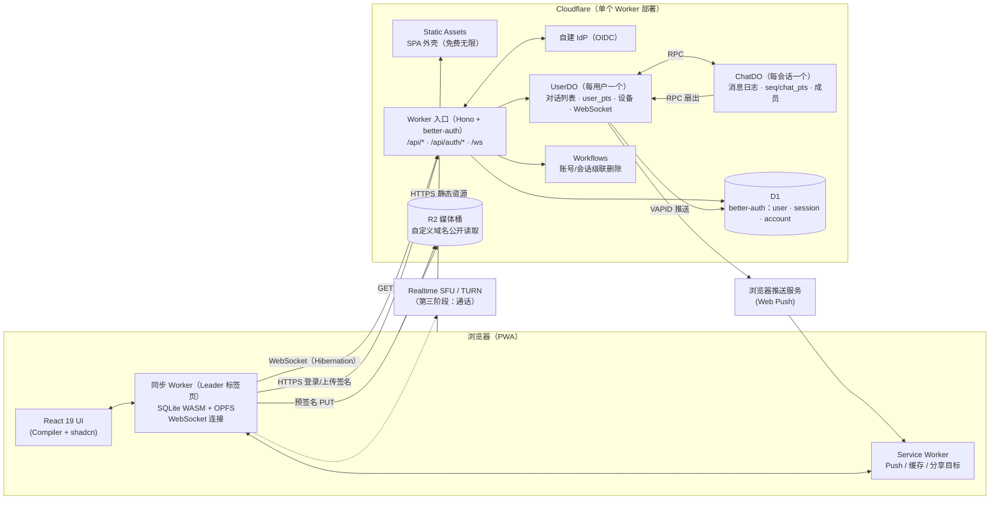

# Web Chat 架构总览

一个类 Telegram 的 Web 聊天应用，完全运行在 Cloudflare 开发者平台上。设计取向：

- **尽可能先进**：只面向最新的常青浏览器（Chromium / Safari / Firefox 最新版），不考虑兼容性，不做降级方案。
- **尽量落在 Workers Free 套餐内**：架构围绕免费额度中最紧的指标（DO/D1 **行写入**、DO **请求数**）设计，见 [08-free-tier-budget.md](./08-free-tier-budget.md)。
- **数据只做前向迁移**：从 1.0 起，服务端与本地库的表结构只追加迁移步骤，协议不兼容时旧客户端强制重载，见 [ADR-0013](../adr/0013-forward-only-migrations-after-1-0.md)。

## 一张图看懂

## 核心思想（五句话）

1. **Actor 拆分**：每个用户一个 `UserDO`、每个会话一个 `ChatDO`，二者都是 SQLite 后端的 Durable Object；D1 存放 better-auth 的身份数据与用户名索引。→ [ADR-0001](../adr/0001-actor-split-user-and-chat-do.md)
2. **一条连接**：每个设备只维持一条 WebSocket，连到自己的 `UserDO`，并强制使用 Hibernation API，空闲时不计时长。→ [ADR-0003](../adr/0003-single-hibernating-websocket.md)
3. **写扩散**：群组上限 20 人，所有会话的新消息都扇出到成员的 `UserDO`，成本上界明确；暂不做频道。→ [ADR-0002](../adr/0002-write-fanout-small-groups.md)
4. **双序号同步**：会话内用 `seq`（消息序号）排序，用 `chat_pts`（会话变更序号）增量同步；用户级用 `user_pts` 同步对话列表。客户端用 `random_id` 保证发送幂等。→ [03-sync-protocol.md](./03-sync-protocol.md)
5. **本地优先**：客户端把消息存进 OPFS 上的 SQLite WASM，UI 只读本地库，搜索也在本地做（FTS5 trigram），服务端不承担搜索写入成本。→ [ADR-0004](../adr/0004-local-first-client.md)

## 阅读顺序

| 文档 | 内容 |
| --- | --- |
| [01-topology.md](./01-topology.md) | 运行时拓扑、Cloudflare 产品选型、请求路由、部署形态 |
| [02-data-model.md](./02-data-model.md) | D1 / UserDO / ChatDO / 客户端四处的表结构与所有权 |
| [03-sync-protocol.md](./03-sync-protocol.md) | 帧格式、序号模型、发送 / 接收 / 断线补齐、缺口检测 |
| [04-realtime-and-fanout.md](./04-realtime-and-fanout.md) | 写扩散、调用限额、输入中 / 在线状态、已读回执、Web Push |
| [05-media.md](./05-media.md) | 上传、缩略图、语音 / 视频、分发与缓存 |
| [06-auth-and-security.md](./06-auth-and-security.md) | better-auth Generic OAuth、环境变量、设备管理、限流、XSS / CSWSH 防护 |
| [07-client.md](./07-client.md) | 前端架构：Leader 标签页、SQLite WASM、Service Worker、UI 技术 |
| [08-free-tier-budget.md](./08-free-tier-budget.md) | 免费额度核实表、每操作成本、容量估算 |
| [09-roadmap.md](./09-roadmap.md) | 分阶段路线图、假设、开放问题、新依赖清单 |

术语见仓库根目录 [CONTEXT.md](../../CONTEXT.md)。关键决策记录在 [docs/adr/](../adr/)：

| ADR | 决策 |
| --- | --- |
| [0001](../adr/0001-actor-split-user-and-chat-do.md) | 按用户、按会话拆分 Durable Object |
| [0002](../adr/0002-write-fanout-small-groups.md) | 群组上限 20 人，全部写扩散；暂不做频道 |
| [0003](../adr/0003-single-hibernating-websocket.md) | 每设备一条 Hibernation WebSocket 连到 UserDO |
| [0004](../adr/0004-local-first-client.md) | 本地优先客户端：SQLite WASM + OPFS |
| [0005](../adr/0005-better-auth-generic-oauth.md) | 身份由 better-auth Generic OAuth 对接自建 IdP |
| [0006](../adr/0006-client-side-media-processing.md) | 媒体由客户端处理，预签名直传 R2，通过自定义域名分发 |
| [0007](../adr/0007-block-rejects-explicitly.md) | 拉黑后发私聊直接失败，不静默丢弃 |
| [0008](../adr/0008-pending-media-prefix.md) | 上传先进待发区，靠桶的生命周期规则清理孤儿 |
| [0009](../adr/0009-p2p-private-calls-sfu-group-calls.md) | 一对一通话走 P2P（非联系人强制中继），群组通话走 SFU |
| [0010](../adr/0010-secret-chats-multi-device-mls.md) | 秘密聊天用多设备 MLS，设备由已在组里的设备拉入，服务端像普通消息一样保留密文 |
| [0011](../adr/0011-bots-telegram-compatible-api.md) | （暂缓）Bot 是特殊的 UserDO，API 兼容 Telegram Bot API 的子集 |
| [0012](../adr/0012-shared-sticker-objects.md) | 贴纸对象被所有消息共用，永不删除 |
| [0013](../adr/0013-forward-only-migrations-after-1-0.md) | 1.0 起数据只做前向迁移，协议不兼容旧客户端，旧客户端强制重载 |
| [0014](../adr/0014-template-config-at-top-level.md) | wrangler.jsonc 顶层是给别人部署的模板，chat.jaze.top 的配置在 `env.production`，前端的部署常量构建时从 vars 注入 |

## 现有技术栈（沿用）

| 位置 | 已安装 |
| --- | --- |
| 根目录 | Bun、TypeScript |
| `server/` | Hono 4、Wrangler 4（`compatibility_date: 2026-09-28`） |
| `web/` | Vite 8、React 19 + React Compiler、Tailwind 4、shadcn（`base-maia`，基于 Base UI）、lucide、oxlint |

新依赖清单见 [09-roadmap.md § 新依赖](./09-roadmap.md#新依赖)（已确认；`sonner` 不安装）。清单之外的新依赖仍需先确认。
